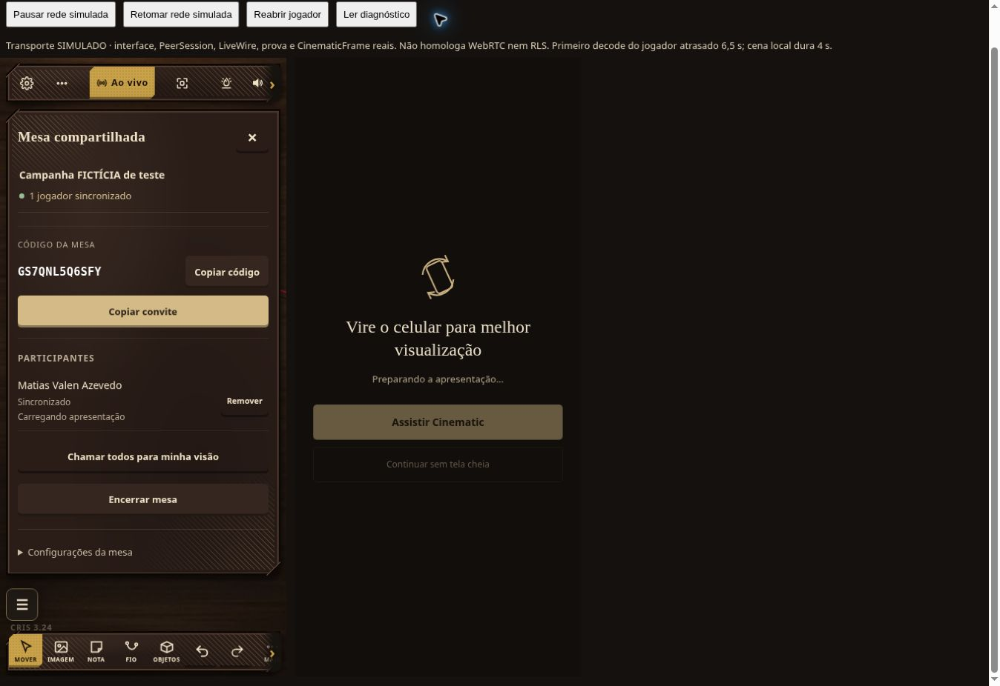
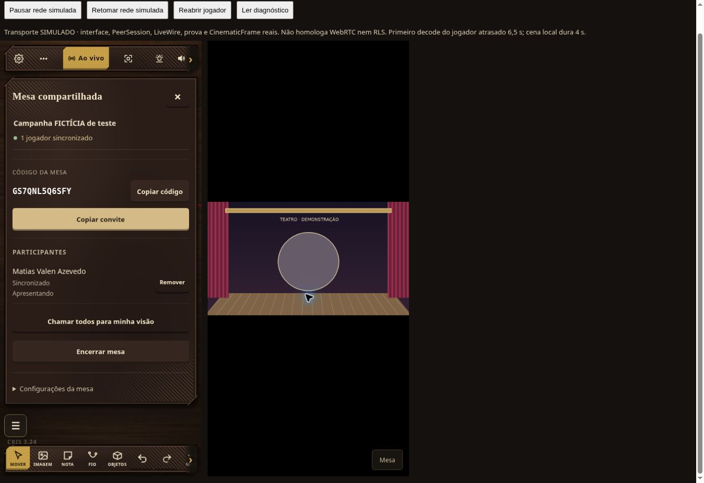
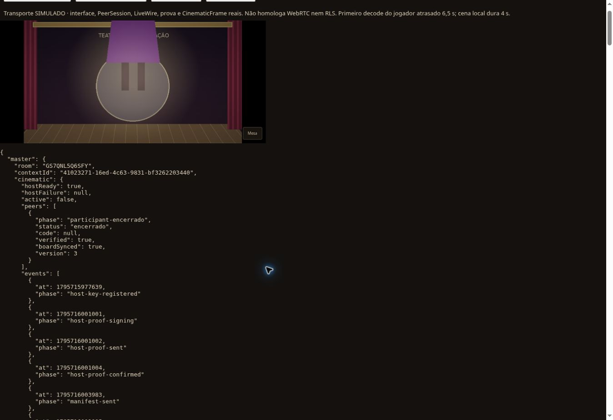

# LIVE-01B.2 · Primeiro play mobile e apresentação

Base: `main` em `960c532`, após o merge do PR #26. Branch: `fix/live-01b2-mobile-cinematic-first-play`. Sem publicação, merge, migração ou alteração de campanhas reais. Audio Engine e renderer preservados.

## Diagnóstico confirmado e limites

O fluxo anterior calculava a posição inicial pelo tempo transcorrido desde a oferta, incluindo transferência e decodificação. Uma apresentação automática curta podia expirar antes da primeira montagem. Além disso, o fim automático do quadro local mandava encerrar os participantes que ainda estavam preparando mídia. O preparo WebM era iniciado sem ser aguardado; a confirmação de apresentação podia anteceder o decoder.

Isso reproduz um mecanismo compatível com o relato de primeira tentativa fria falhar e a segunda funcionar com mídia em cache. **Não confirma a causa exclusiva no celular físico do usuário**: não houve acesso ao aparelho ou aos logs daquela ocorrência. Autoplay, codec, WebView e políticas de fullscreen ainda dependem de homologação real.

| Verificação | Antes | Depois |
| --- | --- | --- |
| Cena automática de 4 s, relógio do receiver avançado 30 s durante carga | Zero montagens; teste falha (`0 !== 1`) | Uma montagem, posição inicial zero; teste passa |
| Quadro real em viewport 390 × 844, primeiro prepare atrasado 6,5 s por fixture | Não executado no navegador antigo | Local termina primeiro; receiver mantém a sessão, confirma mídia pronta e aguarda toque |
| Primeira execução do cenário frio corrigido | — | Um único comando Apresentar, um toque; aproximadamente 4,2 s de reprodução até confirmação de encerramento |
| WebM em 844 × 390 | — | readyState 4, pausado antes do toque, reproduzindo depois; viewport interno ~693,33 × 390 (16:9), letterbox |

Evidência anterior: [before-cold.log](evidence/live-01b2/before-cold.log). Eventos corrigidos, com transporte explicitamente simulado: [first-play.json](evidence/live-01b2/first-play.json) e [browser-final.json](evidence/live-01b2/browser-final.json).

## Correção incremental

1. `prepare` transfere só a mídia autorizada da sessão atual pelo LiveWire existente, com os mesmos limites/hash/ACK/cache.
2. `media-complete` pede montagem **pausada** no CinematicFrame existente. O receiver aguarda imagens e preparo WebM/fallback.
3. `ready` confirma preparo ao mestre; só então ele envia `play`. Primeira entrada começa em zero, sem consumir a duração durante upload/decodificação/toque.
4. No mobile o frame preparado fica coberto pelo aviso. **Assistir Cinematic** inicia no gesto e solicita fullscreen; **Continuar sem tela cheia** segue sem solicitar APIs. Não há retry cego.
5. `apresentando` só é enviado depois de o player iniciar. Falha mostra mensagem curta e informa o mestre. Tempo limite de preparação/gesto continua explícito (180 s).
6. O fim automático local mantém o controle do Director e aguarda confirmação terminal dos remotos. O mestre ainda pode encerrar ou substituir. Não se reinicia o player local.
7. Cancelamento, revisão, geração e identidade da sessão invalidam callbacks antigos. Reconexão retoma apenas sessão ativa, com offset de quem já havia iniciado; quem já concluiu não revive a sessão encerrada.
8. Capacidade Cinematic versão 3 exige atualização dos dois lados. Cliente antigo recebe indicação de atualização; o quadro continua compatível. Imports/CSS alterados usam versão para evitar módulos antigos em cache.

## UX e compatibilidade

O aviso é transitório e mostra “Vire o celular para melhor visualização”; em horizontal, “Pronto para a apresentação”. O botão só habilita após readiness. A superfície preta cobre o quadro, preserva 16:9 e composição sem distorção. O botão Mesa continua disponível durante a apresentação.

Fullscreen depende de suporte, gesto, contexto seguro e política de embedding. `screen.orientation.lock('landscape')` é tentado somente após adquirir fullscreen próprio. Rejeição/ausência não bloqueia o filme: orientação recomendada e letterbox permanecem. Ao encerrar, desfaz apenas fullscreen/lock adquiridos por essa apresentação, restaura o destino do frame, controles e classes do quadro. Não interfere com fullscreen preexistente. Unlock devolve ao comportamento normal do sistema; não força fisicamente retrato nem restaura um lock externo que o browser não expõe.

Referências das APIs: [requestFullscreen](https://developer.mozilla.org/en-US/docs/Web/API/Element/requestFullscreen), [ScreenOrientation.lock](https://developer.mozilla.org/en-US/docs/Web/API/ScreenOrientation/lock). Safari/iOS, WebViews de app/extensão e permissões de iframe podem limitar essas APIs; precisam de teste no runtime de destino. Fallback PNG de WebM permanece o existente.

## Validação executada em 26/11/2026

- `cd campaign-director && npm run check`: aprovado.
- `cd campaign-director && npm test`: **540/540** aprovados (524 na base). [Log](evidence/live-01b2/tests.log).
- `node campaign-director/scripts/check-integration.mjs`: sintaxe de motores e assets aprovada.
- `git diff --check`: aprovado.
- Regressões: primeiro play frio, ready antes de play, decoder pausado, fim local aguardando remoto, encerramento confirmado, cancelamento durante preparação e limpeza de fullscreen, overlay/gesto, orientação/ausência de APIs, fullscreen preexistente, substituição e restauração.
- Chrome na prévia local isolada: fluxo local do mestre e remoto com PeerSession/LiveWire/prova/CinematicFrame reais, **DataConnection simulado**. Cena simples fria, reprodução seguinte WebM, substituição, encerramento antes do toque, desconexão e reentrada na mesa persistida, retomada da preparação ativa, stop; desktop 1440 × 900 com imagem/WebM, substituição e retorno dos dois quadros.
- No teste WebM: `readyState=4`, `paused=true` antes do toque e `paused=false` depois.
- Fullscreen retornou indisponível no browser automatizado; fallback funcionou. Entrada fullscreen/lock e respectivas recusas/limpeza também estão cobertas por doubles de API nos testes, **sem comprovação nativa de lock**.
- Sem Android/Windows físicos, sem homologação entre dispositivos independentes, sem validação de WebRTC/RLS por essa fixture. Não se declara aprovação mobile real.





As capturas mostram a fixture e não são um mockup da interface de produção. A horizontal usa zoom de visualização da própria fixture; as dimensões internas foram verificadas separadamente no DOM.

## Reprodução isolada da fixture

```sh
node campaign-director/tests/fixtures/live-mobile-cinematic-demo.mjs /tmp/cris-live01b2-qa
cd /tmp/cris-live01b2-qa
# Servir public/ em localhost com o servidor estático de sua preferência.
# Abrir room-qa.html?case=first-play&cold=1
```

Use um diretório novo. Escolha 390 × 844; abra mesa no mestre, copie o código para o jogador e entre. Clique **Curta · primeiro play** uma vez; a fixture atrasa somente o primeiro prepare do jogador 6,5 s e a cena local dura 4 s. Aguarde o botão habilitar, toque e confirme encerramento. WebM testa reprodução seguinte. Redimensione para 844 × 390 durante a apresentação; 1440 × 900 testa desktop. “Ler diagnóstico” atualiza a evidência renderizada. A fixture não se conecta a dados reais e declara o transporte simulado.

## Homologação pendente · Windows + Android

Em uma **implantação HTTPS de teste separada**, feita por quem mantém o ambiente, usar backend/projeto de teste e campanha descartável. Não apontar testes para campanhas reais nem executar migrações em produção. Carregar os arquivos desta branch; manter preview protegido conforme o ambiente. O desenvolvimento nesta tarefa não implantou esse ambiente.

1. Usar mestre no Chrome/Edge Windows e jogador em Chrome Android, com contas de teste diferentes. Repetir também no app/WebView/extensão de destino, registrando versão do navegador e do Android.
2. No celular, abrir contexto limpo para a prévia (não apagar dados do CRIS real), entrar por link/código e confirmar sincronização/presença única. Sem apresentar antes, mandar uma cena automática simples de 4 s **uma vez**.
3. Em retrato, confirmar aviso e botão aguardando preparo. Tocar **Assistir Cinematic** uma vez; girar fisicamente para landscape. Verificar frame inteiro, ausência de UI sobre a cena e estado “Apresentando” no mestre. Registrar fullscreen/lock efetivos ou fallback, sem tratar a recusa como sucesso dessas APIs.
4. Encerramento automático deve devolver quadro/controles, sem sessão presa nem orientação temporária. Repetir segunda cena e comparar com a primeira. Repetir em rede limitada: carga maior que a duração local não pode cancelar a cena remota antes do toque.
5. Testar composição de camadas/câmera/luzes/efeitos, fundo WebM e camada WebM transparente com fallback. Verificar WebM realmente animando; fallback estático deve ser registrado como tal, não como sucesso de vídeo.
6. Repetir **Continuar sem tela cheia**, recusa de fullscreen e rotação manual. Desktop local e remoto continuam apresentando sem gate mobile.
7. Substituir cena durante carga, durante aviso e durante reprodução. Encerrar antes do toque e durante o vídeo. Nenhum callback/comando velho deve reviver a anterior; UI/locks restaurados em todos os casos.
8. Desligar/religar rede durante cena ativa; reentrar na mesma mesa e verificar sessão vigente. Reconectar após término não pode revivê-la. Não duplicar presença.
9. Após todas as cenas, enviar imagem no quadro, mover objetos/cursores e comparar conteúdo/posições nos dois dispositivos. Verificar ausência de conteúdo oculto e impossibilidade de jogador iniciar/encerrar remotamente.
10. Guardar diagnóstico avançado já existente (sem tokens/SDP bruto/mídia privada), gravação do primeiro play, estados por participante e resultado de fullscreen/orientação. Só aprovar a correção real após primeira execução simples e WebM passarem no Android de destino.

## Arquivos

- Player/readiness: `dist/cinematic-frame.js`, `cinematic-composition.js`, `cinematic-video.js`.
- Transporte/estado: `dist/cinematic-remote.js`, `cinematic-protocol.js`, `cinematic-link.js`.
- Mobile: novo `dist/cinematic-presentation.js` e `cinematic.css`.
- Integração: `quadro/board-cinematic.js`, `board-live.js`, `index.html` e espelhos em `integration-main/quadro` e `dist/cris/quadro`.
- Verificação: `scripts/check.mjs`, testes de lifecycle/remote/presentation/board-live, nova fixture `tests/fixtures/live-mobile-cinematic-demo.mjs` e esta documentação/evidências.
