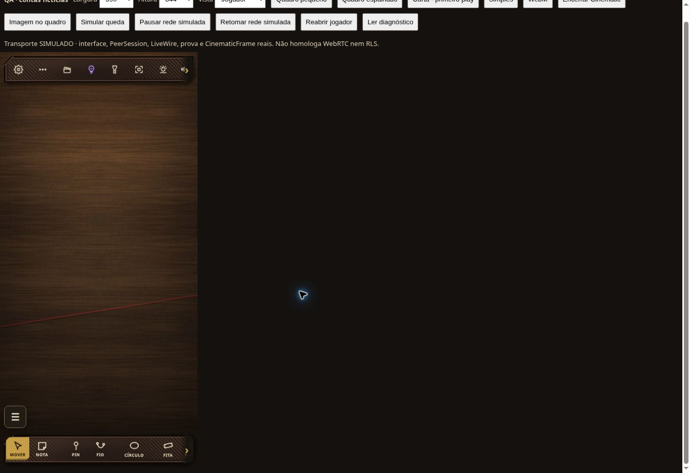
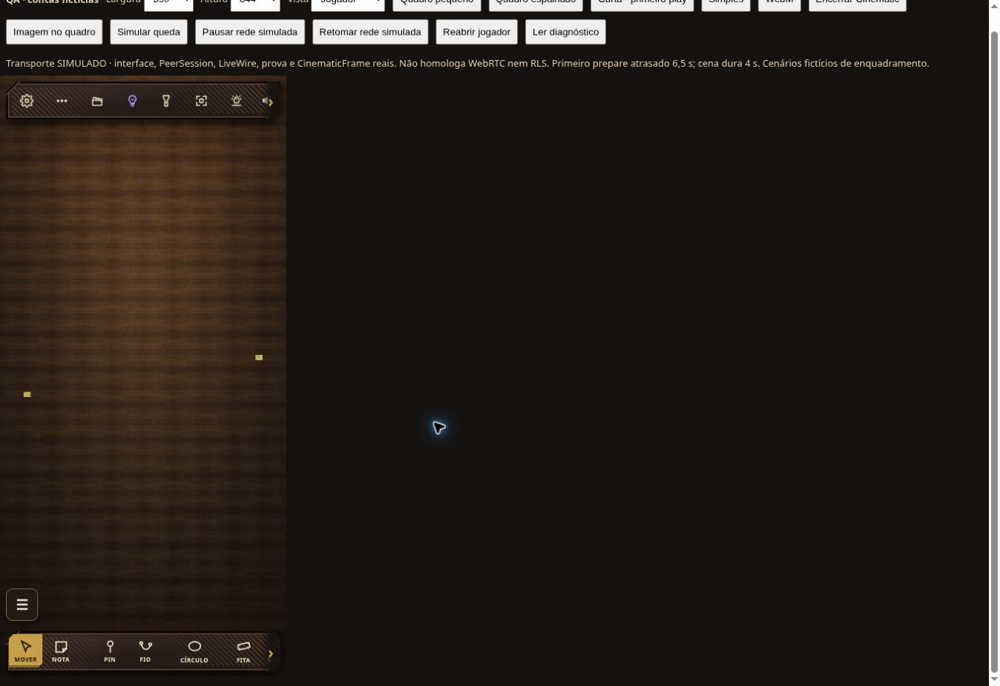
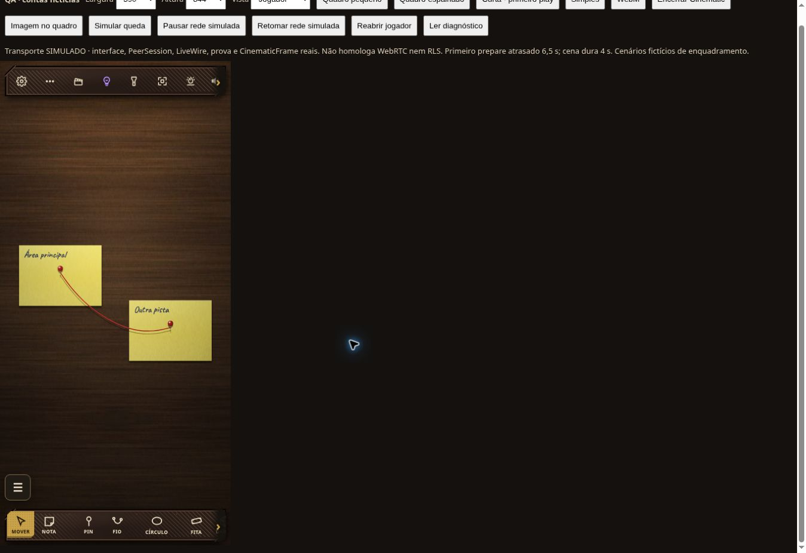
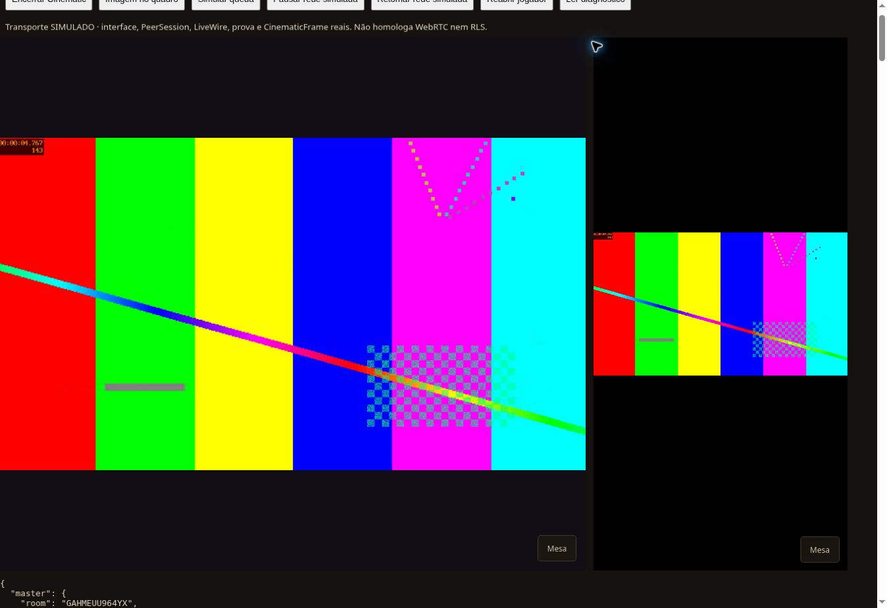

# LIVE-01B.3 · Cinematics coordenadas e enquadramento

Base `6055803` (main após PR #27). Branch `feature/live-01b3-synchronized-mobile-cinematics-board-focus`. Sem publicação, merge, infraestrutura nova ou alterações de campanhas reais. Mesmo CinematicFrame, renderer e Audio Engine.

## Diagnóstico

O mestre possuía mídia local e começava antes de distribuir arquivos. O jogador precisava receber Base64 fragmentado, verificar SHA e preparar o decoder. LIVE-01B.2 também aguardava um gesto obrigatório no mobile. Não existia barreira de preparo compartilhada.

A medição controlada identificou custos diferentes: conversão Base64 no receiver, validações repetidas do mesmo Blob e principalmente espera sequencial de ACK por fragmento sob RTT simulado de 20 ms. Isso não constitui diagnóstico da rede física do usuário. O vídeo grande abaixo tem 3.829.001 bytes de mídia (WebM + PNG), distribuídos em 5.105.691 caracteres de payload JSON. Esse volume de aplicação não inclui envelopes/ACK/SCTP nem mede bytes reais de rede.

O enquadramento tinha dois limites mínimos de zoom: 0,12 em U() e um wrapper mobile que o elevava a 0,28. Em quadros espalhados, as pistas ficavam fora da tela mesmo após enquadrar. U() também era chamado a cada snapshot, sobrescrevendo a câmera do jogador. O cálculo anterior ignorava pins soltos e aproximava dimensões por um raio quadrado.

A validação visual encontrou outro defeito preexistente: um WebM sem janela temporal continuava reproduzindo, mas sua opacidade virava zero após a primeira duração da cena. A regressão agora verifica opacidade/fallback aos 29 s, além de currentTime/paused.

## Mudanças implementadas

- **Preparar → pronto → agendar → reproduzir**: quadro local monta pausado, mídia autorizada é transferida e cada receiver confirma preparo/decoder antes do início comum.
- O Director recebe aceitação de preparo imediatamente e continua enviando heartbeat; não confunde essa aceitação com player iniciado. O mestre mantém controles de cancelar/substituir durante a espera.
- O instante de início usa o relógio do mestre, amostra de RTT/offset e antecedência pequena: mínimo de 800 ms para o aviso e entrega do comando, adaptável até 2 s pelo RTT medido. Não se aplica atraso fixo de vários segundos ao carregamento.
- Todos começam a timeline a partir desse instante; atraso de entrega ou da promessa play() entra no seek. Entradas tardias retomam a posição vigente sem reiniciar os demais. Cena automática já expirada não é revivida.
- Aos **20 s**, participantes lentos são indicados e o painel existente da mesa oferece **Prosseguir com os prontos**. Quem terminar depois entra na posição correta. O limite de preparo do participante permanece **180 s**. Desconectados e incompatíveis não são tratados como prontos; falhas são explícitas.
- Mobile prepara conectado ao DOM, invisível e sem cobrir o quadro. Perto do início aparece **Vire o celular**; o aviso desaparece automaticamente e não pede confirmação. O filme ocupa a página com fundo escuro/letterbox 16:9, acompanha resize sem reiniciar e restaura os controles ao sair.
- `muted` e `playsInline` preservados. Fullscreen/orientation lock não são condições de autoplay nem são pedidos obrigatoriamente. Um controle de recuperação só aparece após **NotAllowedError real**. Falha de decoder mantém o fallback PNG existente, distinguido nos diagnósticos/estado remoto.
- **Janela de no máximo quatro fragmentos** apenas na Cinematic. O quadro continua usando um por padrão. Mensagens duráveis continuam sequenciais; hash completo, ACK final após aplicação, retry, cancelamento, limites de filas e segurança continuam ativos. Não é um segundo transporte.
- Conversão Base64 para array de bytes por laço tipado; cache de hash por **identidade do Blob imutável**, sem dispensar verificação de bytes novos. Cache de mídia por hash reaproveita apresentações diferentes, limitado a **24 MiB e 64 entradas**, com limpeza após encerramento.
- U() usa limites reais, rotação/escala, proporção decodificada e pins visíveis. Removeu-se o wrapper mobile que cortava a visão geral. A primeira carga enquadra após ze()/imagens; ressincronização e reconexão preservam navegação já escolhida. Interação durante a carga invalida o enquadramento pendente.
- **Centralizar quadro** no menu CRIS reutiliza U(). O convite **Chamar todos para minha visão** continua opt-in e adapta a região à proporção do receptor. Uma interação nova cancela uma animação de convite ainda em curso.
- Ajuda curta, uma vez por sessão de navegador mobile, usando o toast existente: arrastar fundo, pinça com dois dedos e toque em objetos. Gestos existentes foram conferidos no motor; não se adicionou minimapa/painel permanente.
- Capacidade Cinematic **v4** e imports versionados: atualizar mestre e jogadores. Clientes antigos continuam no quadro, mas recebem indicação de atualização para Cinematics.

Não há escolha automática arbitrária de uma pista central. Quando objetos visíveis estão muito espalhados, a visão geral pode deixá-los pequenos; o jogador pode aproximar ou aceitar a referência do mestre. Itens ocultos não entram no enquadramento nem na mídia remota.

## Medições reproduzíveis

Benchmark Node: RemoteCinematics e LiveWire reais, SHA real, rede simulada com RTT 20 ms; decoder representado por esperas de 40/100 ms. Relógios dos participantes têm offset simulado. Não mede decoder Android, WebRTC físico ou igualdade de frames desenhados. São amostras de execução, não percentis nem promessa de sincronização perfeita.

| Cena / cache | Tempo até último início antes | Depois | Diferença entre inícios antes | Depois |
| --- | ---: | ---: | ---: | ---: |
| Imagem, 2 jogadores, frio | 212 ms | 981 ms | 212 ms | 1 ms |
| Imagem, 2 jogadores, quente | 154 ms | 943 ms | 154 ms | 0 ms |
| Camadas + WebM, 2 jogadores, frio | 253 ms | 1.111 ms | 253 ms | 0 ms |
| Camadas + WebM, 2 jogadores, quente | 154 ms | 942 ms | 154 ms | 0 ms |
| WebM grande, 1 jogador, frio | 9.903 ms | **3.566 ms** | 9.903 ms | 0 ms |
| WebM grande, 1 jogador, quente | 243 ms | 952 ms | 243 ms | 0 ms |

O mestre agora espera readiness e antecedência de início; por isso casos pequenos/quentes não começam instantaneamente. O ganho do arquivo grande não é obtido diminuindo qualidade ou retirando integridade. O custo de recepção/verificação medido externamente caiu de aproximadamente **726 ms** para **45 ms** na rodada com janela de quatro; valores variam com CPU/concorrência. Uma etapa intermediária, ainda com ACK serial, mostrou que apenas otimizar Base64 não eliminava a espera por RTT.

Oito solicitações de hash sobre o mesmo Blob passaram de oito leituras do buffer para uma. No cache quente, a apresentação grande não retransmite seus arquivos. Hash de outro Blob, inclusive alterado, continua sendo calculado/verificado.

Evidências: [antes](evidence/live-01b3/benchmark-before.json), [etapa com ACK serial](evidence/live-01b3/benchmark-serial-optimized.json), [depois final](evidence/live-01b3/benchmark-after.json). Campos antigos chamados `wire` nesses logs significam caracteres JSON de aplicação, não tráfego físico.

### Navegador com player real

Chrome em prévia local isolada; contas fictícias, DataConnection simulado. Engines, PeerSession, LiveWire, prova do mestre, BroadcastChannel local e CinematicFrame reais. Isso não equivale a dois dispositivos independentes.

- Cena de 4 s, primeiro prepare do jogador atrasado **6,5 s**: mestre permaneceu pausado; primeiro comando iniciou automaticamente sem toque e encerrou corretamente. Desvio relativo de início medido na timeline ~**10,5 ms** nessa rodada.
- WebM opaco grande: transferência ~**631 ms**, preparo real de imagem ~18 ms e vídeo ~43 ms; primeiro frame disponível ~689 ms após recepção. Início do mestre +2 ms e jogador +1,5 ms relativamente ao alvo (diferença ~0,5 ms). Esses tempos locais não incluem RTT de 20 ms injetado no benchmark Node.
- Vídeo confirmado com `readyState=4`, `paused=false`, **opacidade 1** e fallback oculto; screenshot mostra o padrão VP9 real nos dois lados. O ciclo sem janela não se torna transparente após a primeira volta.
- Composição de camadas/alpha usou o fallback existente no mestre em uma rodada em que o probe de transparência foi recusado; o jogador reproduziu WebM. Não se apresenta esse fallback como sucesso de vídeo transparente. O caso opaco grande teve zero fallbacks nos dois lados.
- Confirmados substituição, cancelamento antes de iniciar, encerramento manual/automático, rotação sem reinício, retorno dos dois quadros, câmera igual antes/depois de reconectar, presença única e imagem do quadro ainda sincronizada.
- Enquadramento visual em **360×800, 390×844, 844×390, 768×1024 e 1440×900**, com notas/pins/fio; imagem grande e itens espalhados/ocultos em cenários separados. Menu Centralizar funciona por toque/clique e teclado. Fixture usa zoom de visualização em telas largas; medidas no JSON são internas ao iframe.

Métricas são início efetivo da timeline/play() e disponibilidade decodificada; não garantem a mesma varredura de tela/composição GPU entre máquinas. `videoMs` pode sobrepor o preparo de imagens. Na imagem simples, `firstFrameMs` inclui transferência e preparo, não apenas rede.

[Primeiro play frio](evidence/live-01b3/browser-final-cold.json) · [WebM grande](evidence/live-01b3/browser-release-large.json) · [Vídeo visível](evidence/live-01b3/video-visible-loop.json) · [viewports](evidence/live-01b3/focus-viewports.json) · [reconexão/câmera](evidence/live-01b3/reconnect-camera.json) · [imagem/itens ocultos](evidence/live-01b3/board-after-image.json).

### Transporte nativo e aparelho físico

Teste separado com RTCPeerConnection nativo, sem PeerJS e com STUN público: troca de oferta/resposta ocorreu, gathering completou, mas **zero eventos de candidatos utilizáveis e zero candidatos remotos**. getStats encontrou dois locais por PeerConnection, ausentes do SDP exposto. O DataChannel expirou em ~8 s. [Evidência](evidence/live-01b3/native-rtc.json).

Esse teste reproduz uma limitação do ambiente automatizado, sem comprovar causa específica de rede/implementação. Não se adicionou TURN nem infraestrutura. **Não houve Windows/Android físicos nem homologação entre dispositivos reais nesta tarefa.** O relato anterior do usuário de conexão real funcionando continua sendo evidência da versão anterior, não homologação desta branch.

## Capturas

Antes: pistas em x=±5.000 ficaram fora da viewport.



Depois: a visão geral inclui os dois extremos. Objetos tão distantes ficam pequenos por necessidade geométrica.



Quadro pequeno: pistas legíveis e fio centralizados, item secreto distante excluído.



Vídeo grande real (padrão de teste sintético), sem autorização obrigatória no jogador.



## Checks e regressões

- `npm --prefix campaign-director run check`: aprovado.
- `npm --prefix campaign-director test`: **557/557**, base 540. [Log](evidence/live-01b3/tests.log).
- `node campaign-director/scripts/check-integration.mjs`: aprovado. [Log](evidence/live-01b3/integration.log).
- `git diff --check`: aprovado.
- Regressões: barreira com múltiplos tempos de preparo; offsets de relógio; atraso da promessa play(); entrada tardia; timeout/prosseguir; cancelamento/substituição; cache entre cenas; identidade de Blob/hash alterado; autoplay recusado; gesto excepcional; rotação/limpeza; WebM visível após 29 s; janela de fragmentos limitada com ACK perdido/retry, hash corrompido, ordem de operações e fechamento liberando pendências; fit de imagens rotacionadas/pins/outliers em cinco viewports, câmera de referência e zoom gradual a partir de visão geral.
- Proteções anteriores de identidade do mestre, projeção de mídia oculta, escopo, hashes e áudio continuam passando. Não houve alterações no Audio Engine.

## Reprodução das medições

Usar Node compatível com as APIs Web já utilizadas no projeto. FFmpeg é opcional apenas para gerar o arquivo grande de teste; não é uma dependência do app.

```sh
# Baseline histórica, sem alterar a branch atual:
git worktree add --detach /tmp/cris-b3-before 6055803

# Vídeo de teste VP9 opaco, sem áudio, dentro dos limites:
ffmpeg -hide_banner -loglevel error -f lavfi -i 'testsrc2=size=1280x720:rate=30' -t 8 -an -c:v libvpx-vp9 -b:v 6M -deadline realtime -cpu-used 8 /tmp/cris-b3-large.webm

# Substituir /caminho/cris pela raiz absoluta do checkout atual:
node campaign-director/tests/fixtures/cinematic-sync-benchmark.mjs /tmp/cris-b3-before /tmp/cris-b3-large.webm
node campaign-director/tests/fixtures/cinematic-sync-benchmark.mjs /caminho/cris /tmp/cris-b3-large.webm

# Fixture com os dois quadros, mídia e ações descartáveis:
node campaign-director/tests/fixtures/live-sync-focus-demo.mjs /tmp/cris-b3-qa /caminho/cris /tmp/cris-b3-large.webm
# Servir /tmp/cris-b3-qa/public em localhost.
# Abrir room-qa.html?case=teste&cold=1 (atraso de primeiro prepare de 6,5 s).
```

Diretórios de saída devem ser novos. Abrir mesa no mestre, copiar código para jogador, aguardar snapshot. “Curta · primeiro play” dura 4 s; não tocar no jogador. “WebM grande” exige a mídia opcional passada ao gerador. “Ler diagnóstico” lê o relatório renderizado a cada 500 ms; aguardar atualização entre ações para não ler a amostra anterior. A fixture declara seu transporte simulado e não grava no backend.

## Homologação Windows + Android pendente

Usar implantação HTTPS **isolada**, contas e campanha descartáveis, backend de teste. Não apontar para campanhas reais. Esta tarefa não criou/publicou implantação. Atualizar os dois dispositivos para esta branch (capacidade v4).

1. Mestre no Chrome/Edge Windows, jogador no Chrome Android; depois repetir no app/WebView/extensão utilizado pelos jogadores. Registrar versões e rede. Ambos em primeiro plano.
2. Entrar por convite/código, validar região visível, margem, ausência de itens ocultos e ajuda de gestos. Navegar, reconectar e comprovar que a câmera não foi sobrescrita. Testar Centralizar e aceitar/recusar chamada de câmera do mestre com proporções diferentes.
3. Em cache vazio, apresentar cena simples de 4 s uma única vez, sem toque no jogador. Verificar mestre pausado durante preparo, aviso breve e início comum. Comparar primeira e segunda reprodução em cache.
4. Repetir composição de várias camadas, câmera/luzes/efeitos, fundo WebM e alpha. Conferir movimento visível após várias voltas, fallback quando necessário e tempos por participante. Não confundir PNG com vídeo funcionando.
5. Com 2+ jogadores e rede lenta, observar estados por participante. Após 20 s, testar Prosseguir com os prontos e chegada do atrasado na posição correta; desconectado/incompatível/falhou devem permanecer distinguíveis.
6. Testar cancelar antes do início, substituir durante transferência/decoder/aviso/reprodução, encerrar manual/automaticamente e reconectar durante/depois. Nenhuma sessão antiga deve reviver. Alterar orientação no meio sem reiniciar a timeline nem pedir autorização.
7. Testar recusa real de autoplay: só então deve surgir recuperação. Fullscreen/lock recusados ou ausentes não podem impedir a apresentação. Ao sair, confirmar UI, câmera e áudio normais.
8. Depois do filme, enviar imagem, mover objetos/cursores e comparar quadro/visibilidade/integridade nos dois lados. Não duplicar presença. Jogador não pode iniciar/encerrar apresentação de outro participante nem assumir mestre.
9. Guardar diagnóstico avançado sem tokens/SDP bruto/mídia privada e gravação de ambos os dispositivos para comparar início visual. Aprovar Android somente após estes passos no aparelho físico.

## Arquivos principais

- `dist/cinematic-{remote,protocol,link}.js`: coordenação, relógios, estados e cancelamento.
- `dist/cinematic-{frame,composition,video,presentation,media}.js`, `cinematic.css`: preparo, autoplay, visibilidade, telemetria e cache.
- `quadro/board-live.js`: janela opcional de ACK e matemática de enquadramento.
- `quadro/quadro-cris-v7.js`: U(), snapshot/câmera e camcall existentes, sem reconstruir motor.
- `quadro/board-session.js`, `board-room-ui.js`, `board-cinematic.js`, `index.html`: menu, progresso e integração.
- Espelhos em `campaign-director/integration-main/quadro` e `dist/cris/quadro`, mantidos por `scripts/sync-live-board.mjs` (agora também inclui board-session).
- Testes de foco, transporte, protocolo/player/gesto, fixtures de benchmark e QA; ajuste da fixture antiga para imports versionados.
