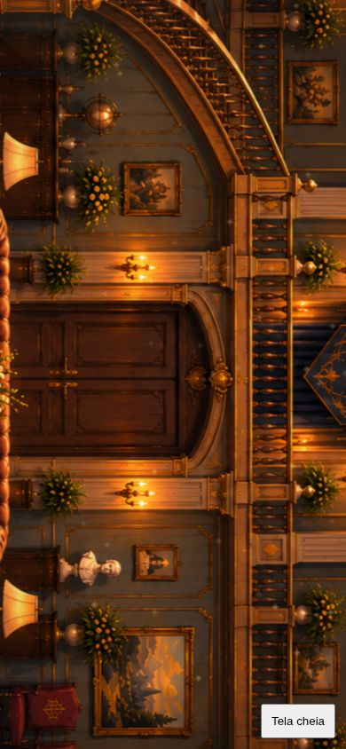
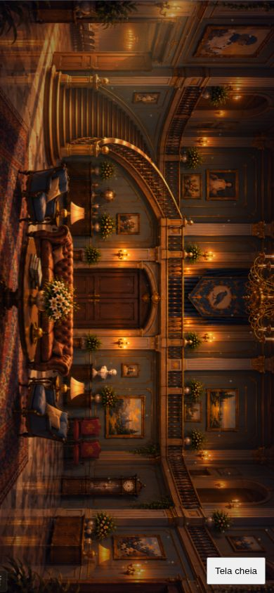
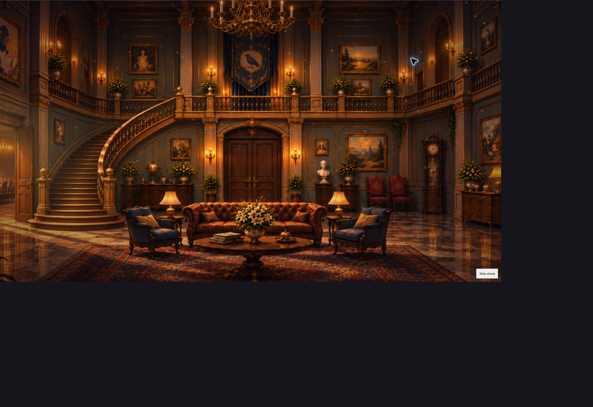

# MOBILE-FIT-01 · UX-013

Branch `fix/mobile-fit-01-cinematic-framing`, baseada em `b151128` (main após merge do PR #36), em 28/11/2026. Entrega para revisão, sem merge ou implantação. Requisito permanece **Parcial** até homologação Android/PWA. [PR #37, em rascunho](https://github.com/MateusAnastacio599/cris-reescritos/pull/37). Implementação em `0b5f0ef6c85788527240f617f2896b889f0f2277`.

## Diagnóstico confirmado

`fitComposition` dimensionava o mundo usando `viewport.getBoundingClientRect()`. Esse retângulo **já inclui** as transformações CSS. No portrait, o frame possui layout horizontal **844 × 390**, mas seu retângulo visual, após os 90°, mede **390 × 844**. Aplicar cover com esse segundo retângulo e colocar o resultado dentro do primeiro produz uma segunda ampliação indevida, cortada pelo overflow do frame.

No Chromium, com marcadores 16:9 e câmera neutra, o mundo anterior media **1500,44 × 844** dentro do frame lógico 844 × 390. A composição perdia 43,75% da largura e 53,79% da altura. Após a correção, mede **844 × 474,75**: 0% de recorte horizontal e 17,85% vertical, exatamente o mesmo cover do landscape equivalente. Não há distorção ou contain num quadro menor.

A implementação mantém a fórmula cover/contain e troca somente a origem da medição: `clientWidth/clientHeight` na montagem e `ResizeObserverEntry.contentRect` nas atualizações. Esses valores pertencem às coordenadas locais anteriores à transformação. Notificações com tamanho zero não substituem o último encaixe válido. O observer continua sendo desconectado no ciclo de limpeza existente. Nenhuma chamada a play, seek, recriação de player ou decoder é introduzida no resize.

O palco CSS de 90° permanece intacto, assim como `object-fit`, iluminação, caminhos de câmera, parallax, WebM, redução de movimento, fade, pré-roll de 1800 ms, countdown, autenticação, transporte, cache e Audio Engine. As demais alterações de produção propagam `?v=mobilefit01` pelo grafo que importa o helper (Frame/Studio/quadro e entradas). Protocolo e identificadores de capacidade v4 não mudam; as três distribuições do quadro recebem referências coerentes.

## Medições reais no Chromium

Fixture com os componentes **reais** CinematicPresentation, CinematicFrame, loadComposition, iluminação e vídeo. Não usa conta, documento de campanha nem transporte remoto. As nove resoluções são viewports de iframes no Chromium, **não dispositivos físicos**. Cada linha foi medida após nova montagem e preparação; continuidade é testada separadamente sem remontar.

Imagem sintética: 1600 × 900, marcadores nos extremos, centros e cantos, topo/lustre e base/mesa/sofá. Câmera neutra (zoom 1), tempo 3 s. Valores de recorte representam percentuais totais nos eixos da imagem original, antes da rotação; cada margem centralizada perde aproximadamente metade. Não representam o zoom intencional da câmera. A precisão exibida pelo CSS pode arredondar centésimos de pixel.

| Viewport físico/lógico CSS | Rotação artificial | Recorte anterior X / Y | Recorte corrigido X / Y | Mundo corrigido (CSS px) |
| --- | --- | --- | --- | --- |
| 390x844 | 90° | 43.75% / 53.79% | 0.00% / 17.85% | 844.00 × 474.75 |
| 360x800 | 90° | 43.75% / 55.00% | 0.00% / 20.00% | 800.00 × 450.00 |
| 412x915 | 90° | 43.75% / 54.97% | 0.00% / 19.95% | 915.00 × 514.69 |
| 844x390 | 0° | 0.00% / 17.85% | 0.00% / 17.85% | 844.00 × 474.75 |
| 800x360 | 0° | 0.00% / 20.00% | 0.00% / 20.00% | 800.00 × 450.00 |
| 915x412 | 0° | 0.00% / 19.95% | 0.00% / 19.95% | 915.00 × 514.69 |
| 1920x1080 | 0° | 0.00% / 0.00% | 0.00% / 0.00% | 1920.00 × 1080.00 |
| 1440x900 | 0° | 10.00% / 0.00% | 10.00% / 0.00% | 1600.00 × 900.00 |
| 1366x768 | 0° | 0.00% / 0.05% | 0.00% / 0.05% | 1366.00 × 768.38 |

Nas três resoluções desktop, dimensões do mundo e frame são idênticas antes/depois. `comparison.json` registra os dados derivados e o verificador exige paridade desktop e melhora superior a 2× na área visível mobile. Isso é um critério de regressão da fixture, não um novo limite oficial de recorte. Para 16:9 numa tela lógica 800 × 360, os 20% verticais restantes são a diferença real de proporção do cover; não foram ocultados com outra ampliação.

### Referência visual da mansão

Foram inspecionadas as duas capturas fornecidas pelo usuário. Para a comparação controlada, a **captura desktop** foi usada como uma imagem de teste com câmera neutra; não foi acessada ou modificada a campanha original. O arquivo da referência tem **1844 × 911** (aspecto 2,024:1), portanto não se deve atribuir a ele o aspecto 16:9 da outra fixture. A cena original, configurações e timestamp não estão disponíveis nessas imagens.

No viewport 390 × 844, o mundo dessa referência passou de **1708,38 × 844** para **844 × 416,965**. Recorte X/Y: **50,60% / 53,79% → 0% / 6,47%**. A área visível da imagem sobe de aproximadamente 22,83% para 93,53%. Zoom neutro, tempo 3 s e a mesma rotação nas duas capturas. O arquivo original da referência não é incluído como asset do produto; capturas e medidas do ensaio estão versionadas.

| Antes | Depois |
| --- | --- |
|  |  |

### Controle desktop visual

A mesma referência em 1920 × 1080 mantém mundo, frame, câmera e percentuais de recorte idênticos antes/depois (`desktop-before.json` / `desktop-after.json`). Capturas abaixo mostram o viewport interno reduzido visualmente a 60% pelo harness para caber na janela da automação; a área externa escura é a página de teste, não barras dentro do player.

| Desktop anterior | Desktop corrigido |
| --- | --- |
|  |  |

## Continuidade, vídeo e limpeza

- WebM de fundo (VP9 opaco 320 × 180, 2 s) com fallback de mesmo aspecto, mais camada WebM transparente/fallback PNG existentes. Ambos chegaram a `readyState=4`, sem erro. Ao girar 390 × 844 → 844 × 390 durante reprodução, tempo da cena avançou **3,0333 → 3,167 s**; vídeos **1,033 → 1,167 s**. Mesmas instâncias de composição e vídeos, mesma geração e um único início. Registro: `video-continuity.json`.
- Câmera com movimento intencional de zoom 1 → 1,2 em 30 s e camada com parallax: tempo **3,0333 → 3,2585 s**, transform continuou aproximadamente **1,02011 → 1,02156**, sem novo início. Iluminação real do preset de teatro: escuridão 0,24, vinheta 0,35, uma luz e duas camadas; world com clipping `hidden`. Registros: `camera-continuity.json`, `lighting.json`.
- Caminho de imagem simples sem composição/câmera também foi apresentado e medido; continua usando `object-fit:cover` no frame rotacionado correto (`simple.json`). Nesse caminho não existe `.cinematic-world`: suas dimensões no relatório são derivadas do object-fit, e o campo de transform reflete o frame rotacionado, não um zoom de câmera. O defeito reproduzido afetava o cálculo do mundo das composições.
- Encerramento retornou `stopped:true`, classe de modo de apresentação removida e zero roots remanescentes. Novas apresentações e substituições foram exercitadas em seguida no mesmo componente.
- Fullscreen solicitado por gesto no Chromium retornou `fullscreen-unavailable`; os vídeos continuaram. A tentativa é registrada em `fullscreen.json`; os testes unitários existentes cobrem API permitida/negada/ausente e limpeza. **Fullscreen permitido não foi homologado em navegador real nesta execução.**

A captura congelada da cena garante comparação no mesmo instante; os ensaios de continuidade usam reprodução ativa. A coleta lê DOM/renderização e o relatório do harness, sem alterar campanhas ou estados reais.

## Viewport, safe areas e limites

O defeito foi demonstrado com `innerWidth/innerHeight` iguais a `visualViewport.width/height`, escala 1, sem fullscreen. Portanto não depende de fullscreen, cache, autoplay ou bloqueio de orientação para acontecer ou para ser corrigido. As dimensões lógicas locais são independentes da rotação ou da escala visual de ancestrais; as atualizações continuam sob o ResizeObserver existente. Não se aplicou uma compensação artificial de câmera ou uma nova política de recorte.

CSS `dvw/dvh`, rotação em portrait, detecção existente de mobile e controles com safe-area continuam preservados. Não se adicionou padding preto à imagem. Barras Android, recortes/notch, mudanças reais do visualViewport, pinch zoom, PWA instalada, fullscreen permitido e comportamento iOS ainda exigem homologação física. A fixture reduzida não carrega a UI inteira do quadro e não é uma sessão WebRTC independente. Os testes completos de integração continuam sendo necessários, mas não equivalem a um teste físico de sessão sincronizada.

## Regressões e reprodução

- **646/646 testes** aprovados (baseline da main: 641). Cinco regressões novas em `cinematic-mobile-fit.test.js`: coordenadas locais de palco rotacionado; nove tamanhos; observer fracionário preservando câmera/tempo; contain em ancestrais escalados e tamanho zero; paridade desktop.
- Fakes antigos dos testes de cover/contain agora fornecem dimensões locais, em vez de somente um bounding rectangle. Testes de versões verificam o novo grafo e as entradas das três distribuições do quadro.
- `npm --prefix campaign-director run check` e `node campaign-director/scripts/check-integration.mjs`: aprovados.
- `git diff --check`: aprovado antes do commit. Fixture JS/generator verificados com `node --check`.

Reproduzir os componentes isolados (diretório novo, somente dados fictícios):

```sh
node campaign-director/tests/fixtures/mobile-fit-demo.mjs /tmp/cris-mobile-fit-qa
sites-preview start /tmp/cris-mobile-fit-qa
```

A referência é opcional: passar seu caminho PNG como terceiro argumento ao gerador. Sem referência, selecionar Marcadores 16:9, imagem simples, câmera/luz ou WebM. Clicar **Testar nove resoluções**, aguardar o relatório, salvar JSON. **Testar continuidade** inicia reprodução e muda as dimensões sem remontar. **Focar palco** esconde a UI do harness; em desktop, reduz visualmente o iframe a 60% para a captura caber no monitor da automação, mantendo o viewport interno e as medidas originais. Não modifica os componentes de produção. O gerador não serve campanhas reais. `background.webm` é um padrão técnico gerado com ffmpeg, VP9 sem áudio; as mídias alpha vêm das fixtures existentes.

Comparar duas matrizes:

```sh
node campaign-director/tests/fixtures/mobile-fit-compare.mjs before-matrix.json after-matrix.json
```

## Arquivos alterados

Lógica: `dist/cinematic-composition.js` (somente medição do fit). Referências de cache: `cinematic-frame.js`, `cinematic-layers-editor.js`, `cinematic-editor.js`, `app.js`, entrada do Director e `board-cinematic.js`/`index.html` nas três distribuições. Sem alterações de matemática de câmera, luzes, CSS de rotação, modelos/campanhas, banco, Audio Engine ou transporte.

Testes: novo `cinematic-mobile-fit.test.js`, fakes de `cinematic-preroll.test.js`/`cinematic-studio-polish.test.js`, referências em `live-visual-compat.test.js`, gerador/harness/comparador em `tests/fixtures/mobile-fit*`. Documentação: este relatório, evidências e **somente UX-013** no backlog. Nenhuma implementação de STUDIO-UX-01B/02.

## Homologação Android/PWA

1. Em implantação isolada de revisão, conferir versão atual do quadro e usar campanha fictícia. Não publicar nem alterar campanha real para testar.
2. Apresentar a imagem de marcadores 16:9 e uma composição com personagens nos extremos, com câmera neutra. Em portrait, confirmar a apresentação tombada, imagem grande, extremos horizontais visíveis e recorte proporcional limitado no eixo vertical. Comparar com o landscape físico equivalente.
3. Repetir navegador e PWA instalada, barras visíveis/recolhidas, botão fullscreen permitido/negado e aparelho com safe areas. Conferir que quadro e controles voltam após encerrar.
4. Apresentar com câmera, luzes, parallax e WebM/fallback; girar durante a cena. Câmera e vídeos devem continuar no mesmo instante, sem flashes/reinício/desalinhamento. Não neutralizar zoom definido pelo mestre ao julgar o enquadramento.
5. Mestre Windows + jogador Android independentes: primeira reprodução, substituição, encerramento, reabertura, pré-roll/countdown e início coordenado existentes. Confirmar desktop 1920 × 1080 / 1440 × 900 / 1366 × 768 sem regressão.
6. Registrar capturas, versões, viewport e limites observados antes de concluir UX-013. Emulação e medições deste PR não autorizam marcar Concluído.
