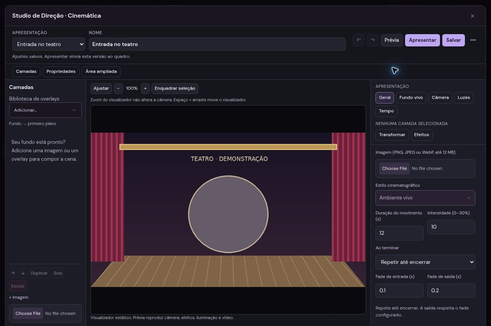
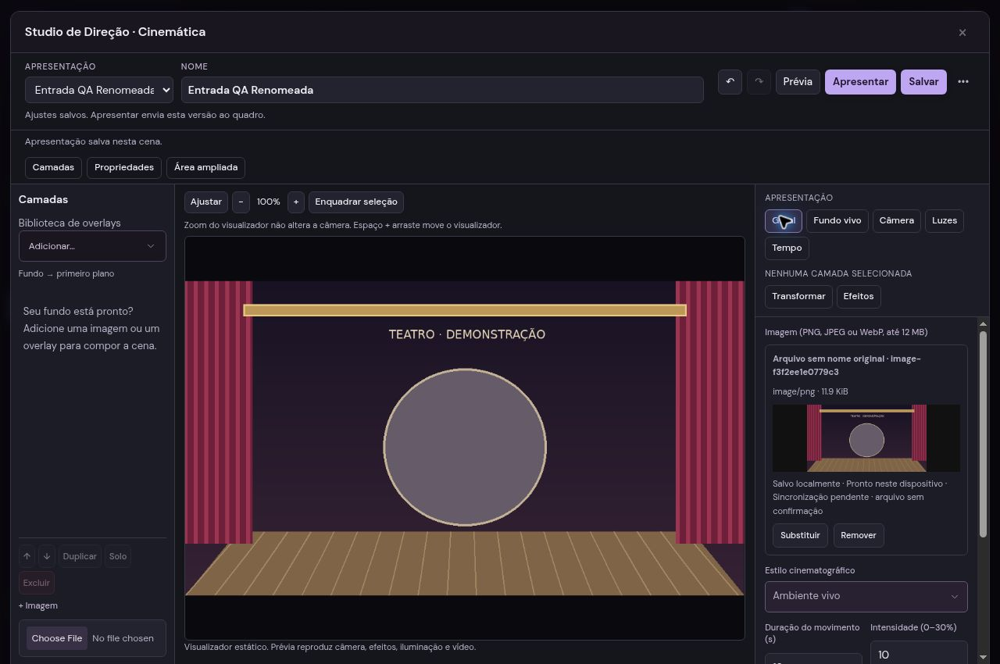
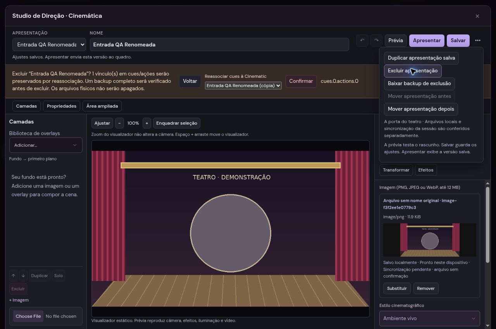

# STUDIO-UX-01A · CRUD, arquivos e estados

Implementação para revisão, em 28/11/2026, baseada na `main` `f4958ba5045d2ae47a2be628efda089e62c7e9e7` (PRs #33, #34 e #35 integrados). Branch: `feature/studio-ux-01a-crud-media-status`. Escopo: UX-002, UX-003 e UX-007 do [backlog oficial](STUDIO-UX-BACKLOG.md). Os três continuam **Parciais**, aguardando homologação e revisão; os demais IDs não foram implementados.

## Operação e segurança

O Studio reutiliza criação, seleção, renomeação, duplicação e salvamento existentes. O menu **Mais** acrescenta ordenação antes/depois, **Excluir apresentação** e **Baixar backup de exclusão**. A ordenação preserva IDs, principal e autorização de preload. Fechar o editor atualiza a seleção da lateral de Direção.

A exclusão exige confirmação. `cinematicUsage` verifica ações `cinematic-start` nas cues (inclusive compostas), triggers, timeline e início da cena, seguindo o escopo por cena do executor existente. Blocos do roteiro e triggers que apontam para uma cue preservam seus IDs. Havendo vínculos, é necessário escolher outra Cinematic salva da mesma cena para reassociar as ações. Se for a última apresentação vinculada, a exclusão fica bloqueada até retirar os vínculos no editor do roteiro. Não há substituição por busca de texto no roteiro nem remoção de ações de áudio. Ao excluir a principal, uma única restante é escolhida automaticamente; com várias restantes, é obrigatória a escolha explícita. A autorização de preload da apresentação removida também é retirada.

Antes da mutação, o exportador completo existente cria um backup do workspace e das mídias referenciadas. O JSON é armazenado na base de mídia já existente, relido e conferido por SHA-256; um índice local por conta mantém as versões anteriores. Falha de exportação, mídia necessária ausente, quota, gravação ou integridade **impede a exclusão**. Mudança de cena/rascunho durante o backup aborta a operação. Falha no salvamento local restaura a cena anterior. Não há exclusão física de imagens, vídeos, áudios ou objetos do Storage. Mídias compartilhadas permanecem intactas.

O menu permite escolher uma versão do backup para baixar; a restauração utiliza o importador de backup completo já existente em Conta e nuvem. A exclusão salva não entra no histórico de desfazer do rascunho. Os backups ficam locais, podem ocupar espaço significativo e não são uma cópia externa: baixar e guardar uma cópia é recomendado antes de manutenção. Esta entrega não implementa coleta automática de backups ou de mídias órfãs.

## Arquivos e estados

Cartões reaproveitam `cinematicImages`, hashes e o manifesto privado da sincronização existente, sem segunda biblioteca ou novo banco. Cobrem imagem de fundo, imagem de camada, WebM de fundo e de camada. Exibem nome conhecido ou identificação pelo hash, MIME, tamanho, miniatura para imagens, disponibilidade, integridade e ações **Substituir**/**Remover**. WebM usa identificação textual, sem criar outro decoder somente para miniatura.

A seleção inicia validação; um arquivo válido substitui a aparência do seletor por seu cartão. Substituir reutiliza o importador e seus limites. Remover desassocia o rascunho, volta ao seletor e permite desfazer/refazer. Remover WebM preserva o PNG de fallback. Remover o PNG de uma camada também retira seu vídeo do rascunho. Como o modelo exige imagem base/fallback, salvar e pré-visualizar ficam bloqueados enquanto a associação obrigatória não for reposta (ou a camada removida). Remover fundo também retira seu WebM do rascunho; o arquivo físico e a versão salva não são apagados.

| Evidência | Estado mostrado | Limite da afirmação |
| --- | --- | --- |
| Seletor recebeu arquivo | Arquivo selecionado · Validando | Não implica persistência |
| Importação/validação concluída | Arquivo validado · Alterações não salvas | Associação ainda pode estar em rascunho |
| Blob relido do IndexedDB com hash correto | Salvo localmente · Pronto neste dispositivo | Não garante que o documento do rascunho foi salvo; este tem estado separado |
| Sincronizador ocupado sem manifesto confirmado | Sincronizando sessão · arquivo sem confirmação | Estado da sessão, não percentual de upload daquele arquivo |
| Manifesto da revisão confirmada, mesma conta, caminho privado, hash, MIME e tamanho | Salvo na nuvem · revisão N | Última confirmação do backend; não consulta disponibilidade do servidor a cada segundo |
| Sem confirmação / erro / conflito | Pendente / Falha de sincronização da sessão / Conflito, com arquivo sem confirmação | Selecionar ou salvar localmente nunca confirma upload |
| Blob ausente ou hash divergente | Arquivo indisponível / Erro de integridade | Não declara pronto |

Nomes de arquivos novos sobrevivem ao IndexedDB e são metadados opcionais no manifesto cloud; downloads verificados recuperam o nome quando disponível. A identidade continua por hash. Um arquivo legado sem nome usa identificação alternativa, sem inventar nome original. Arquivos idênticos com nomes diferentes compartilham identidade e podem exibir o último nome conhecido. O backup completo preserva bytes, hashes e referências; seu formato existente não preserva necessariamente o nome original. Nenhuma migração SQL é necessária para esse metadado opcional do manifesto JSON.

## Aviso de câmera: causa reproduzida

O elemento de validação ficava vazio, mas a regra genérica `.form-error` ainda aplicava fundo vermelho, borda e padding. Na página real do Studio, a caixa vazia tinha **24 px** de altura. A correção é local: `.cinematic-studio .form-error:empty { display: none; }`. A caixa vazia passa a **0 px**; um zoom inválido ainda mostra o erro real e, corrigido para valor válido, o texto e a caixa desaparecem. Não foi necessário alterar matemática, renderer ou editor de câmera. [Medição DOM](validation/studio-ux-01a/camera-validation.json).

Também foram corrigidos: uso da imagem já otimizada/validada na prévia; leitura de chave vazia após desassociação; fechamento do menu Mais antes da confirmação (seu overlay podia interceptar o clique); atualização da lateral ao fechar o editor. Arquivos auxiliares de edição/importação e CSS recebem uma nova referência de cache `studioux01a`, propagada aos importadores afetados. O build/protocolo do renderer permanece inalterado.

## Evidências visuais

Capturas do Director real, com CSS completo, dados fictícios e adapters de conta/persistência de teste. Não são capturas da campanha do usuário nem homologação Supabase/WebRTC.

| Antes | Depois |
| --- | --- |
|  |  |

A captura da confirmação foi feita antes do ajuste do rótulo técnico para o nome da cue; a implementação final mostra o nome quando disponível. A seleção de versões de backup foi acrescentada depois dessas capturas e está coberta pelos testes do histórico de recuperação, mas sua exportação pela UI ainda precisa de homologação manual.

## Validação executada

- Baseline: **624 testes**. Resultado final: **641/641**, zero falhas, skips ou cancelamentos (`npm --prefix campaign-director test`).
- `npm --prefix campaign-director run check`: aprovado (módulos, imports, shell, CSS, manifesto e assets).
- `node campaign-director/scripts/check-integration.mjs`: aprovado.
- `git diff --check`: aprovado antes do commit.
- Regressões novas em `cinematic-crud.test.js` e `cinematic-file-status.test.js`; referências de cache verificadas em `live-visual-compat.test.js`.

Os testes verificam CRUD por modelo; reassociação sem alterar IDs de cue, texto, áudio e timeline; principal obrigatória; bloqueio da última vinculada; falha de backup e rollback de salvamento; edição concorrente; ordenação; backup completo, restauração por hash, corrupção e histórico de versões; estados local/cloud separados; manifesto de outra conta/caminho inválido; pendência/erro/conflito; nomes legados e novos; metadados cloud recuperados por um armazenamento independente em memória; associação vazia sem leitura de chave inválida.

**Browser real / dados e rede simulados:** Chrome automatizado, viewport desktop, Studio real. Foram exercitados criar com imagem fictícia, renomear/salvar, duplicar, fechar/reabrir, selecionar principal, excluir com reassociação e preservar cue, excluir sem vínculos, remover fundo e desfazer, substituir PNG e WebM de camada, salvar/fechar/reabrir e conferir nomes, preservar fallback, erro de câmera inválido → válido. A criação do backup precedeu uma exclusão bem-sucedida. Os testes destrutivos usaram somente fixtures descartáveis. As últimas melhorias de histórico de backups e fechamento automático do menu têm testes de helpers/check; o picker final de versões não teve novo ensaio completo no navegador.

**Limitações:** o evento de download do backup não foi capturado com sucesso pela automação; não afirmar exportação ponta a ponta homologada. Nenhum teste físico Windows/Android foi executado. Falhas cloud, conta diferente, download e upload foram exercitados com adapters/testes, não contra Supabase real. SQL, RLS e sincronização PC A → notebook B continuam na homologação G-33. O upload no navegador automatizado foi lento; isso não é benchmark de desempenho do produto. Nenhum dado real foi alterado, SQL aplicado, objeto de Storage excluído, renderer/Audio Engine modificado, merge ou implantação realizado.

## Arquivos e reaproveitamento

- Novos `cinematic-crud.js` e `cinematic-file-card.js`: regras de exclusão/recuperação/ordenação e apresentação de mídia/status.
- `cinematic-editor.js`, `cinematic-layers-editor.js`, `cinematic-background-editor.js`, `cinematic-studio-ui.js`, `cinematic-studio.css`: integração incremental com formulário, confirmação, histórico e propriedades existentes. Botões antigos redundantes de remover vídeo ficam ocultos em favor do cartão; seus handlers existentes são preservados. Não houve limpeza ampla de código.
- `cinematic-import.js`, `cloud-cinematic-media.js`, `app.js`: nome opcional, adaptador de estados reais e callbacks de backup/invalidação/atualização da direção.
- `cinematic-direction-editor.js`, `cinematic-studio-properties.js`, `cloud-ui.js`, `cloud-workspace.js`, `workspace-sync.js`, `cinematic.css`, `index.html`: propagação das referências versionadas dos módulos/CSS modificados.
- Dois testes novos, teste de compatibilidade de cache atualizado, este relatório, backlog e evidências em `docs/validation/studio-ux-01a/`.

## Homologação curta Windows/Android

1. Usar ambiente de revisão isolado e campanha fictícia. Antes, exportar backup completo e confirmar restauração em outro perfil descartável. Homologar G-33 separadamente, sem aplicar SQL em produção por esta entrega.
2. No Windows, criar duas apresentações com arquivo compartilhado; renomear, duplicar, ordenar, salvar e reabrir. Marcar principal e inserir uma cue composta com Cinematic e áudio. Excluir a principal: cancelar primeiro, depois reassociar e escolher nova principal; conferir cue, texto, áudio e arquivo compartilhado. Tentar excluir a última vinculada e confirmar bloqueio.
3. Baixar duas versões do backup de exclusão pelo menu e restaurar a mais antiga pelo importador existente num perfil de teste. Conferir mídias e hashes, sem sobrescrever campanha real. Simular quota/mídia ausente: exclusão deve abortar preservando a cena.
4. Trocar/remover/desfazer imagem de fundo e de camada; trocar/remover WebM e conferir PNG transparente/fallback; salvar e reabrir. Testar arquivo legado sem nome, tipo inválido, arquivo ausente e cancelamento do seletor.
5. Induzir erro real de câmera e corrigi-lo, sem trocar de aba. Confirmar caixa vazia ausente, estado de rascunho separado do arquivo local, prévia pronta apenas após preparação.
6. Depois da homologação SQL/RLS isolada, simular falha de upload/conflito e confirmar ausência de “Salvo na nuvem” para arquivo não confirmado. Em perfil/computador independente, baixar a mesma revisão e conferir nomes, bytes e hash; outra conta não deve obter mídia privada.
7. No Android navegador/PWA, conferir cartões, seletor Substituir, confirmação, validação e fechar/reabrir; testar PNG transparente e WebM suportado. Revalidar cue → pré-roll → apresentação remota existente. Isso não homologa enquadramento mobile UX-013, que segue fora deste PR.
