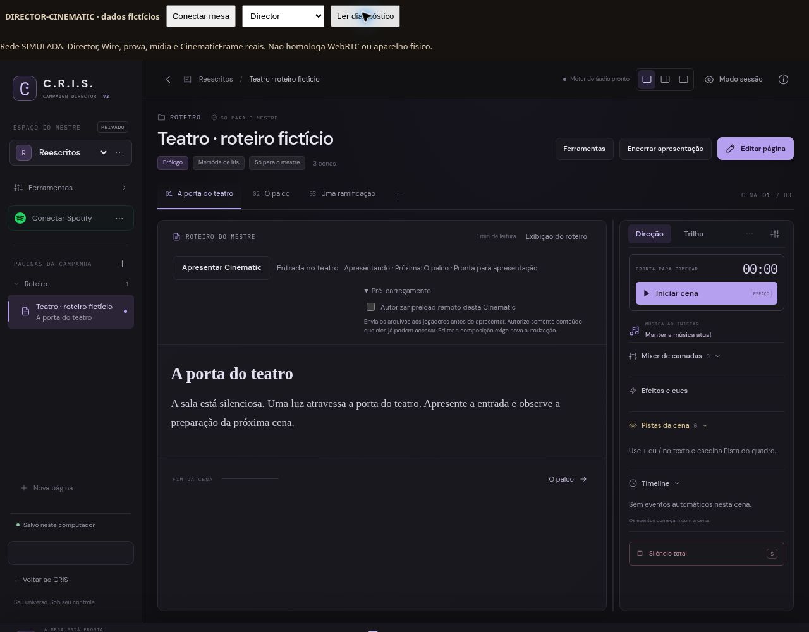
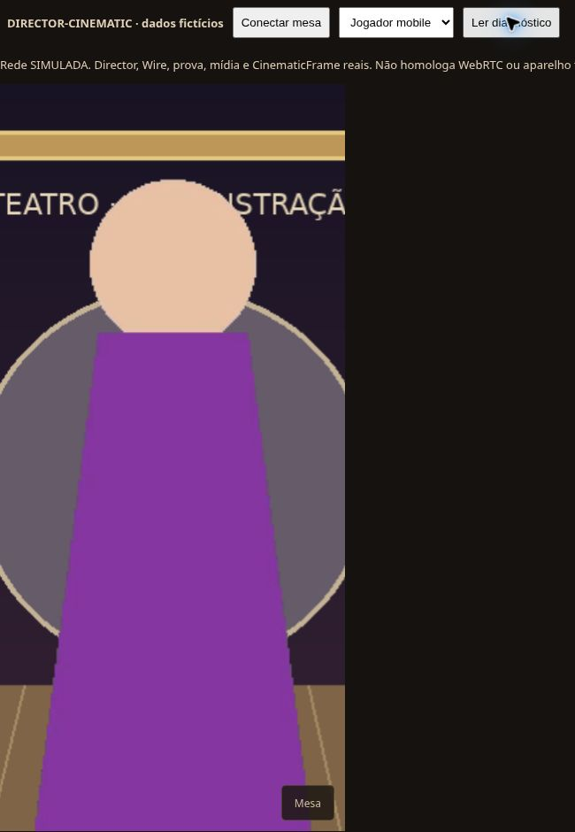

# DIRECTOR-CINEMATIC-01 · roteiro e prewarm progressivo

**Registro histórico:** a integração posterior do #31 ocorreu fora de main. A entrega atual e a correção de reentrada estão em [DIRECTOR-CINEMATIC-02](director-cinematic-02-readiness-landscape.md).

Validação de 27/11/2026. Nenhum merge, deploy, migração ou acesso a campanhas reais. Branch `feature/director-cinematic-progressive-prewarm`.

## Base auditada

A LIVE-01B.5A ainda está no PR #30 em rascunho, head `8973fdef71d79cf3b88e5c6e03049680b1e2e17e`. `main` está em `c509f0d`. Este trabalho parte desse head e deve ser revisado **sobre a branch do PR #30**, preservando cover e pré-roll. Depois da integração da dependência, ajustar a base para `main`; não integrar antecipadamente este PR sobre a LIVE-01B.4.

## Auditoria e integração

- O vínculo já existe em `scene.cinematic.items`, validado e exportado pelo storage. Não foi criada outra biblioteca ou tabela. `cinematic-start` e `cinematic-stop` continuam passando por `CinematicCues` e `CinematicLink`.
- A ordem das cenas é o array `page.scenes`. A ordem entre páginas segue o agrupamento do sidebar/quick-pages: grupos por `folder || 'Páginas'` na ordem de aparição em `campaign.pages`; dentro do grupo, a ordem do array. `scriptScenes` reproduz essa navegação, sem ordenar por nome/ID.
- A cena com uma Cinematic a usa como principal. Com várias, o mestre escolhe `scene.cinematic.primaryId`. Uma ramificação ambígua interrompe a antecipação, em vez de escolher um alternate ou saltar para conteúdo posterior.
- Uma única ação **Apresentar Cinematic** aparece no cabeçalho do roteiro, inclusive no modo sessão. O Studio permanece no menu Ferramentas para editar. Não inicia áudio ou a cena sonora por consequência.
- O botão usa a mesma apresentação coordenada, readiness por participante, compensação de horário e pré-roll de 1,8 s da LIVE-01B.5A. Com mídia pendente, a preparação vem antes do pré-roll: não há promessa de começar em dois segundos.

## Fila, segurança e prioridade

Selecionar a cena lê e valida somente sua principal localmente. Consentimento explícito em **Pré-carregamento → Autorizar preload remoto desta Cinematic** permite enviar os arquivos dessa apresentação aos participantes autenticados da mesa. O padrão é desligado, inclusive em cenas antigas. A configuração é salva no mesmo documento da campanha; não contém mídia adicional.

Quando o player confirma `apresentando`, a fila identifica **uma** próxima cena com principal na ordem real. Lê seus arquivos sem montar Frame ou decoder. Só distribui esse próximo conteúdo se houver consentimento para ele. Uma próxima privada pode ser preparada no computador do mestre; não é transmitida e não é pulada para antecipar outra cena mais distante.

Trocar/pular cena, alterar ordem, trocar principal, campanha ou composição cancela o trabalho obsoleto e recalcula o alvo. Há no máximo um trabalho local de leitura/hash em andamento e um substituto mais recente; mudanças rápidas não acumulam trabalhos. Ao terminar a cena, a próxima já pronta permanece no cache. Apresentar nunca dispara automaticamente a seguinte.

Editar uma composição salva revoga sua autorização de preload remoto. Duplicar a cena também remove a autorização copiada. O mestre precisa consentir novamente. Camadas ocultas são removidas pelo `publicCinematic` existente antes do manifesto e dos bytes, mesmo em composição autorizada. O fluxo mantém prova criptográfica do mestre, escopo/sessão de mesa, identidade e sincronização do quadro. Mensagens de jogador não iniciam preload no host. Não foi criado público/URL de armazenamento de mídia secreta.

A distribuição usa **o mesmo LiveWire, lane Cinematic, DataConnection e DataChannel**. O protocolo adicional apenas distingue cache de reprodução. Um participante por vez recebe a candidata; janela de um fragmento, slices binárias de 96 KiB, pausa de 8 ms por fragmento. O envio espera se o canal tiver mais de 48 KiB pendentes, se o PeerJS tiver buffer, se a apresentação estiver preparando/iniciando ou se o vídeo local estiver sem buffer. O jogador também sinaliza buffering; o mestre reduz o preload por pelo menos 750 ms. Stop e sincronização de controle continuam fora dessa fila de dados. Cancelamento aborta a transferência especulativa sem desmontar o player atual ou encerrar a conexão.

Entradas tardias são verificadas e recebem somente o alvo autorizado atual. Reconexão perde o estado de prontidão anterior; o novo peer negocia novamente. Cliente v4 sem `cinematicPrewarm:1` recebe estado de atualização necessário para preload e conserva a preparação normal no clique. Não anunciamos sucesso remoto com base na preparação local.

## Cache e limites

O cache remoto existente continua um `Map` efêmero de Blobs por SHA-256, com orçamento de **24 MiB por jogador** para os bytes de mídia cacheados/reservados da atual e candidata juntas. Se a união excede o limite, o preload falha com `cache-budget` e a apresentação atual é preservada. A apresentação seguinte continua possível pelo preparo normal. Não foi aumentado o limite para acomodar toda a campanha.

A atual e a candidata têm preferência; hashes antigos não relevantes são removidos primeiro, em ordem de inserção no cache existente. Arquivos só entram após reconstituição, validação de tipo/limites e SHA. Uma transferência parcial não é arquivo válido; o clique usa os hashes completos recebidos e retoma o preparo normal do que falta. Isso não é retomada por byte de um arquivo incompleto.

No Director há até dois slots de arquivos: atual + alvo, cada composição sujeita aos limites existentes de 24 MiB. Assim, até **48 MiB de referências a Blobs locais**, com deduplicação da contagem por hash; um trabalho de IO temporário pode estar terminando após cancelamento. Essas cifras não são limites do RSS/heap total do navegador: Base64, buffers temporários e o decoder da apresentação atual têm overhead. Nenhuma segunda instância de player é pré-decodificada.

Uma lease de 45 s renovada por heartbeat de 15 s mantém a candidata relevante. Cancelamento/perda da lease permite a limpeza após a graça existente de 30 s, preservando a apresentação ainda ativa. Sair do quadro encerra timers, assemblies e cache; sair da campanha limpa os slots e cancela o alvo remoto. Nenhuma mídia futura é adicionada a armazenamento permanente dos jogadores.

## Estados

A linha da cena informa Não preparada, Preparando, Pronta localmente, Preparando jogadores, Pronta para apresentação ou Falha. Durante a reprodução mostra também o nome/estado da próxima. A prontidão individual fica no painel existente **Mesa compartilhada → Participantes**, com os detalhes em `diagnostics().prewarm`. Falha de preload é independente da apresentação em execução.

## Medições reproduzíveis

Benchmark Node, rede e player **simulados**, Wire/SHA/ACK/prova/orquestração reais. Dois jogadores com atrasos de uma via de 12 ms e 3 ms; candidata de 2.097.162 bytes, decoder simulado de 20 ms, pré-roll de 1.800 ms. Uma rodada por cenário; valores não são SLA nem homologação física. Bytes abaixo somam os dois jogadores.

| Cenário | Clique até o último iniciar | Antecipação antes do clique | Mídia enviada após clique (bytes) | Mídia reutilizada (bytes) | Diferença mestre/jogadores | Maior atraso do event loop durante a atual |
|---|---:|---:|---:|---:|---:|---:|
| A · sem preload | 3628 ms | 0 ms | 4,194,324 | 0 | 2 ms | 5.25 ms |
| B · um de dois jogadores pronto | 2436 ms | 8388 ms | 2,097,162 | 2,097,162 | 1 ms | 74.53 ms |
| C · ambos prontos | 1995 ms | 12426 ms | 0 | 4,194,324 | 1 ms | 114.4 ms |

Pico amostrado do cache por jogador: **2.113.175 bytes**, dentro de 25.165.824. O player atual não foi remontado nem parado nos três cenários. O preload completo reduziu a espera de 3.628 para 1.995 ms (~45%), eliminando 4.194.324 bytes de mídia no caminho crítico.

O atraso do event loop subiu durante o preload: esta medição **não comprova reprodução sem travamentos**. É um proxy de scheduling em Node, sem vídeo real, e inclui serialização/GC da rede simulada. Fullscreen/orientação, FPS, memória total e disputa de CPU do Android precisam de medição física. A implementação contém backpressure e feedback de vídeo, mas não permite prometer impacto zero em todos os aparelhos.

Reproduzir:

```sh
cd campaign-director
npm run check
npm test
node scripts/check-integration.mjs
node tests/fixtures/cinematic-prewarm-benchmark.mjs
node tests/fixtures/director-prewarm-demo.mjs /tmp/cris-director-prewarm-qa
python3 -m http.server 4173 --bind 127.0.0.1 --directory /tmp/cris-director-prewarm-qa/public
```

Abrir `http://127.0.0.1:4173/director-qa.html`, conectar a mesa fictícia e usar os botões reais do roteiro. Essa fixture usa contas/backend e rede simulados; não a publique como aplicação de produção. Nenhum script altera campanhas reais.

## Validação executada

- `npm run check`, **590 testes aprovados**, `check-integration` e `git diff --check`.
- 18 regressões novas: ordem agrupada, principal/ambiguidade, consentimento e revogação, seleção/pulo/troca rápida, limite de leituras, uma próxima, fim preservando cache, conteúdo oculto, transporte/hash/ACK e reuso, um peer por vez, cancelamento e stop, orçamento, entrada tardia/capacidade antiga, edição, arquivos parciais/limpeza, WebM sem segundo player, ponte local do Director e expiração/buffering remoto.
- Chromium 156 com Director e folhas reais do quadro, três frames independentes, rede simulada. Primeira imagem apresentou; próxima composição (imagem + camada + WebM) foi preparada durante a atual. Sem montar vídeo antecipado (`videoCount:0`). Na próxima cena, três hashes reaproveitados, **545.394 bytes reutilizados; zero bytes de mídia enviados após o clique**. O vídeo real ficou `readyState:4`, `paused:false`, `videoCount:1`. Readiness e pré-roll preservados; desvios observados de início: mestre +3 ms e jogador +2 ms.
- Escolha explícita entre dois alternates habilitou a ação; sem escolha a ação ficou desabilitada. Consentimento inicial da cena era desligado. Botão permaneceu disponível no modo sessão. Encerramento manual restaurou quadro e ferramentas; um jogador sincronizado, sem duplicação.
- Layout com autorização aberta: controles terminam em y=435,906 e corpo começa em y=450,906 (coordenadas do iframe); sem sobreposição. Ajustada altura automática do cabeçalho, sem regras globais `!important`.
- A suíte anterior preserva áudio, ferramentas investigativas, proteção/identidade, reconexão, coordenação, cover, iluminação, autoplay e mecanismos WebM. Não foram reescritos renderer ou Audio Engine.





Dados: [benchmark JSON](validation/director-cinematic-01/prewarm-benchmark.json), [diagnóstico do navegador](validation/director-cinematic-01/director-browser-reuse.json). As imagens usam somente composição fictícia de teste.

## Arquivos e alterações

| Área | Arquivos principais |
|---|---|
| Fila/integração | novos `cinematic-sequence.js`, `cinematic-scene-ui.js`; `app.js`, `cinematic-model.js`, `cinematic-cues.js`, `cinematic.css` |
| Cache/transporte | novo `cinematic-prewarm.js`; `cinematic-link.js`, `cinematic-protocol.js`, `cinematic-remote.js` |
| Quadro | `quadro/board-cinematic.js`, `board-live.js`, `board-room-ui.js`; espelhos `integration-main/quadro` e `dist/cris/quadro` |
| Compatibilidade | grafo Cinematic e entradas HTML identificados por `directorcinematic01`; capacidade v4 preservada, capacidade de prewarm negociada separadamente |
| Verificação | `cinematic-sequence.test.js`, `cinematic-prewarm.test.js`, fixtures harness/benchmark/demo, três testes existentes atualizados para o novo stamp |

Não há remoção de player, Studio, cues ou funcionalidades. O carregamento no clique agora reutiliza o slot local; eliminou-se a segunda leitura/hash redundante quando a composição já está preparada. Nenhuma dependência, infraestrutura, schema ou política de acesso foi adicionada.

## Homologação pendente Windows + Android

1. Em ambiente HTTPS de teste isolado, mesmo commit em Director/quadro/PWA, usar duas contas de QA e campanha descartável. Não usar a campanha oficial. Confirmar build `directorcinematic01`, versão v4, `verified:true`, `boardSynced:true` e WebRTC real.
2. Criar cenas A (imagem), B (camadas/luz/câmera + WebM), C (duas alternativas), D (conteúdo privado). Vincular Director ao quadro de QA. Deixar D sem consentimento; autorizar apenas B. Selecionar A no Windows, abrir jogador no navegador Android e depois repetir com app instalado.
3. Apresentar A pelo roteiro. Enquanto A toca, confirmar B recebendo/pronta por jogador no painel; observar vídeo/FPS/cursor e áudio. D não deve aparecer em manifestos ou cache. Nenhum segundo vídeo deve existir antes de apresentar B.
4. Avançar a B e apresentar; registrar `reusedBytes`, `bytes`, `transferMs`, `startSkewMs`, horário do clique/início. Repetir com cache frio, parcial (rede lenta) e completo, ao menos três vezes. Confirmar o pré-roll após readiness, portrait/landscape, cover e encerramento.
5. Trocar rapidamente/pular/reordenar cenas; confirmar cancelamento do alvo antigo. Em C, nada arbitrário até escolher a principal. Editar B, verificar revogação do consentimento e novo hash. Não alterar campanhas reais.
6. Desconectar/reconectar Android e entrar um segundo jogador tarde; prontidão deve ser revalidada sem duplicar presença. Stop/substituição durante preload devem continuar responsivos. Cliente antigo deve pedir atualização para prewarm e poder usar o preparo normal suportado.
7. Testar candidata grande que somada à atual exceda 24 MiB: preload recusado, atual intacta, seguinte preparada normalmente ao clique. Sair da campanha/mesa, aguardar leases/limpeza, confirmar liberação. Observar heap/RSS e FPS em Android físico, incluindo rede restrita e WebM.

Critérios físicos ainda abertos: ausência de regressão perceptível na reprodução atual, FPS/CPU/memória/bateria no aparelho, rede móvel real e cache/update do PWA. Este PR permanece em rascunho até revisão e homologação, sem publicação automática.
