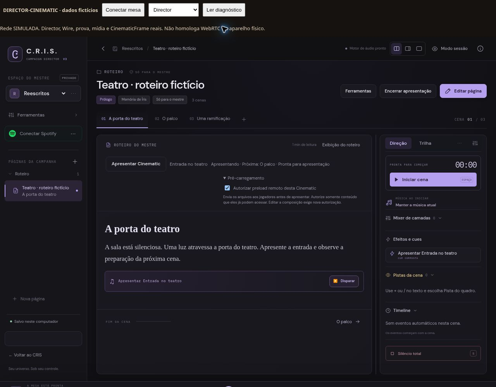
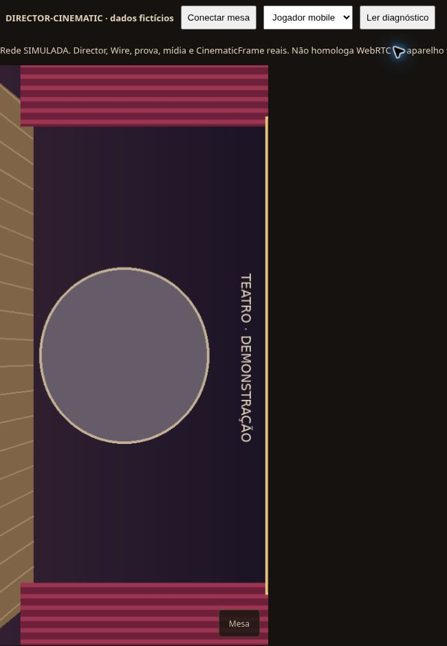
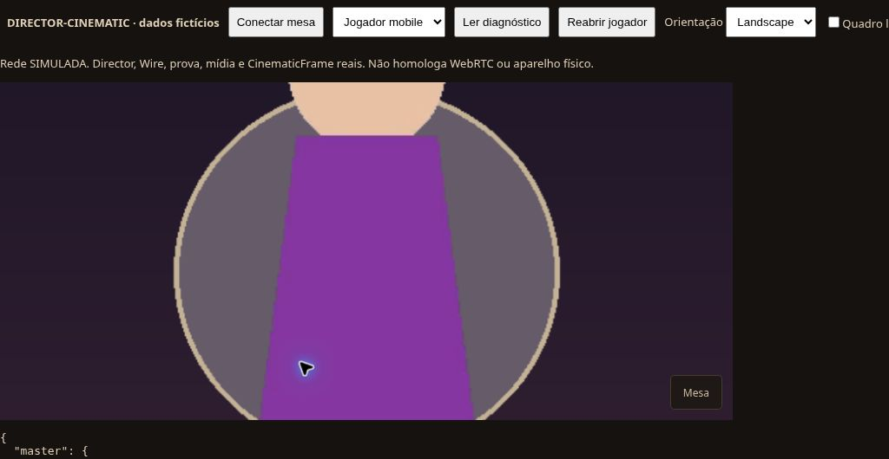
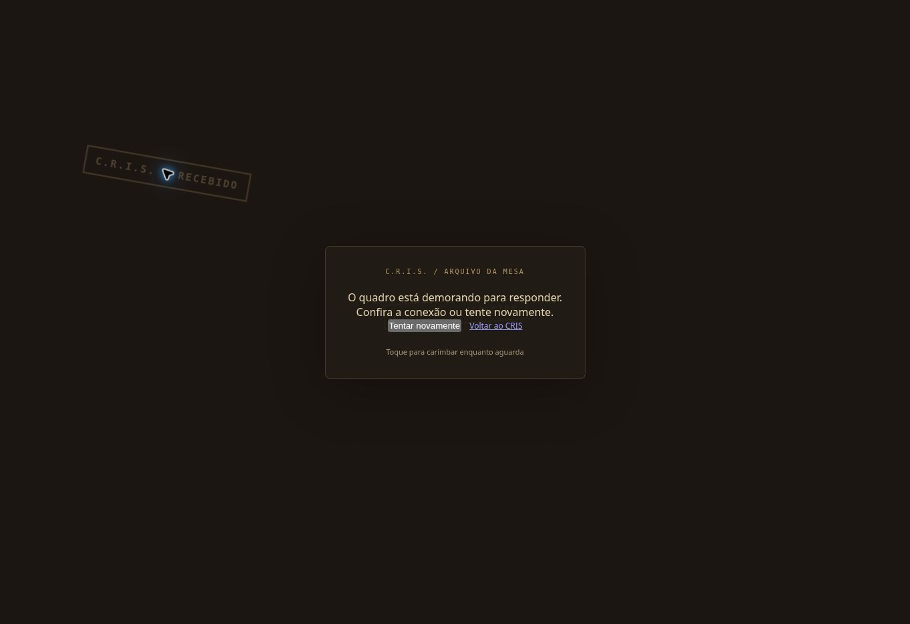

# DIRECTOR-CINEMATIC-02 · reentrada, cue e apresentação deitada

Investigação e correções de 27/11/2026. Branch `fix/director-cinematic-readiness-landscape`, base direta `main` (`6c14d6f`). Sem deploy, merge de PR, alteração de campanhas reais ou mudanças no Audio Engine.

## O que o diagnóstico real comprova

O documento enviado registra **mestre e jogador em `live01b5a`**, jogador instalado em modo `standalone`, protocolo v4, `verified:true`, `boardSynced:true`, ICE conectado e DataChannel aberto. Os erros ICE 701 registrados não impediram essa conexão. Não há evidência de que TURN ou autoplay sejam a causa dessa espera.

Na última apresentação, havia **2.594.423 bytes de mídia**, todos retransmitidos (`reused:0`): transferência **37.812 ms**, preparo **949 ms**, primeiro frame **38.761 ms**, intervalo posterior readiness→play **1.940 ms**. O gargalo registrado é a transferência, não dezenas de segundos de decoder.

O PR #31 foi mesclado na branch `feature/live-01b5a-cinematic-ux-cover-preroll` **depois** de o PR #30 já ter sido integrado em `main`. `main` continuou em `6c14d6f`, sem o commit `69c7f6b` do preload. Isso explica a ausência da integração na imagem do roteiro e no diagnóstico publicado. Este novo PR recupera o conteúdo verificado do #31 sobre a `main` e acrescenta as correções abaixo. Não há dependência de mesclar novamente uma branch antiga.

A primeira tentativa registra encerramento antes de uma segunda negociação. O documento não informa a origem desse encerramento; a causa exata da primeira falha **não foi reproduzida nem confirmada**. Não foi adicionado retry automático de reprodução. O diagnóstico agora registra `director-start-request` e `director-stop-manual/expired/closed/cancelled/automatic`, sem mídia ou credenciais, para distinguir comando recebido, fechamento/expiração e cancelamento em uma nova coleta.

## Fluxo das cenas e da cue

As cenas são exatamente as abas destacadas na captura do usuário. Selecionar uma aba prepara sua Cinematic principal. Quando a atual começa, somente a próxima principal na ordem real do roteiro é antecipada. Nenhuma cena inicia automaticamente.

O preparo remoto permanece **explicitamente autorizado por Cinematic**, em Pré-carregamento → Autorizar preload remoto desta Cinematic. Padrão desligado, revogado após editar a composição, sem envio de camadas ocultas. Sem essa autorização a cena é preparada apenas no computador do mestre. Uma cena com várias opções exige escolha da principal.

No editor, **+ ou / → Cinematic da cena** abre a lista das apresentações já salvas nessa cena. Salvar insere uma cue no ponto do roteiro, com o botão **Disparar** na leitura. É o bloco `cue`, o trigger e a ação `cinematic-start` existentes; não há outro protocolo/player. Inserir novamente a mesma apresentação reutiliza uma cue simples equivalente, sem acumular comandos duplicados. Cues compostas e edição avançada continuam disponíveis no painel existente.

O clique reutiliza a mídia validada e preserva o início coordenado com **1,8 s de pré-roll**. Quando houver arquivo pendente, a preparação deve terminar primeiro; não se promete instantaneidade em rede lenta ou cache frio.

Ao voltar ao Director, uma sondagem leve verifica se a janela do quadro mudou. Não cancela um preload saudável apenas por trocar o foco. Falha ou receiver reaberto dispara nova preparação autorizada, nunca play automático.

## Reentrada sem retransmitir tudo

O cache em memória anterior era apagado ao fechar a página e, após encerramento, limpava em 30 s. Uma reentrada podia voltar a enviar o arquivo inteiro. Agora os bytes já autorizados podem ser reaproveitados por um cache temporário no **mesmo IndexedDB de mídia Cinematic**, em uma store separada `remote-cache`.

- Escopo por conta + campanha + hash. Os jogadores continuam dependendo da prova do mestre e de um manifesto da sessão atual antes de consultar/usar os bytes. Não são persistidos comandos ou estado de apresentação.
- Expiração lógica de **15 minutos**, orçamento global de **24 MiB** e até **64 arquivos**; entradas expiradas/mais antigas são evictadas nas escritas. Dados expirados nunca são reutilizados, mesmo se a limpeza física ainda não ocorreu com o app fechado.
- SHA-256, tipo e tamanho são revalidados ao recuperar do disco. Arquivos parciais não viram cache válido. Conteúdo alterado recebe novo hash e precisa de nova autorização para antecipação.
- Upgrade não destrutivo da base local: a store `images` da biblioteca do mestre é preservada. Cache indisponível, bloqueado ou sem quota usa a transferência normal, sem fingir prontidão. Abertura de IndexedDB tem prazo e mensagem para abas antigas que bloqueiem a atualização.
- O orçamento de memória da apresentação atual+candidata permanece 24 MiB. Não há segundo player ou decoder de WebM antecipado.
- `diagnostics().reentryCache` informa disponibilidade e bytes restaurados. O cache só guarda arquivos que chegaram por uma apresentação/preload autorizado; não distribui bibliotecas ou cenas privadas por conta própria.

O cache é uma otimização e não garante disponibilidade eterna: expiração, evicção pelo orçamento ou pelo sistema operacional exigem transferência novamente. Não apagar dados do app para atualizar.

## Mobile: apresentação realmente deitada

Em viewport mobile portrait, o **próprio CinematicFrame existente** recebe dimensões trocadas e uma rotação CSS de 90°. O palco fica landscape dentro da área portrait. Girar fisicamente o aparelho remove a rotação artificial; o vídeo e a timeline continuam, sem remontagem. Câmera, camadas, luz, atmosfera e vinheta giram juntas. Cover e proporção permanecem, aceitando o recorte já previsto na B.5A.

A rotação visual não depende de gesto nem da API nativa de orientação. O sistema operacional e suas barras não são girados por CSS. Fullscreen nativo/lock continuam sujeitos ao suporte e permissões do navegador; não bloqueiam a apresentação. Referência técnica: https://developer.mozilla.org/en-US/docs/Web/API/ScreenOrientation/lock

Medição no navegador: palco **844 × 390**, matriz `matrix(0,1,-1,0,-422,-195)`, ocupação visível **390 × 844**. Ao passar para landscape: palco **844 × 390**, transform `none`, WebM continuou tocando com `readyState:4` e uma única instância de vídeo. Encerrar remove o modo de apresentação e restaura o quadro.

## Centralização e carregamento do quadro

Causa comprovada no código: `pointerdown` chamava `crisManualCamera`, marcando a câmera como posicionada e incrementando a revisão antes de qualquer arraste. Um toque durante a chegada das imagens suprimia o enquadramento inicial e podia interromper a animação de chamada do mestre.

`watchCameraIntent` passa a distinguir toque de movimento: apenas arraste de pelo menos 8 px ou roda após prontidão contam como intenção manual. Gestos anteriores ao primeiro enquadramento não o cancelam. Chamadas explícitas e um arraste real continuam respeitados.

O loader existente foi ampliado para acompanhar conexão/snapshot ao entrar ou reconectar. O quadro continua coberto até aplicação e sincronização confirmadas, com estado de recepção e opções humanas quando demora. Os carimbos são decorativos, limitados a 16 elementos, sem áudio e com respeito a movimento reduzido. Tocá-los não altera câmera, itens ou campanha. O texto não afirma porcentagem/progresso que o transporte não mede.

## Validação

`npm run check`, `npm test` (**597 aprovados**, 7 testes novos sobre os 590 do #31), `check-integration`, `git diff --check`. A regressão de buffering admite concluir a única slice já em voo após o aviso, sem permitir continuar a fila durante o congestionamento.

Novas regressões: escopo/SHA/expiração do cache, orçamento/evicção, disco indisponível, reabrir cliente sem retransmissão/replay, cue comum sem autorização implícita, toque versus arraste durante carregamento e sondagem do receiver sem reiniciar preload saudável. A regressão de orientação agora verifica ativação/desativação da rotação ao mudar de viewport.

Chromium 156, Director/quadro/CSS/CinematicFrame/IndexedDB reais, contas e **rede simuladas**:

1. Criada cue pelo menu real do editor, salva e disparada pelo botão do roteiro. A primeira apresentação da rodada iniciou, com mídia previamente preparada e zero bytes retransmitidos.
2. Selecionada a aba O palco, sem dar play: três arquivos preparados para o jogador, `active:false`, `videoCount:0`.
3. Apresentada composição com camada + WebM; orientação portrait→landscape sem recriar vídeo; encerramento e UI restaurados.
4. Fechado/reaberto o jogador. A última mesa continuou oferecida, uma única presença, prova/snapshot revalidados. Apresentação encerrada não reviveu. Depois do novo comando, o disco devolveu os três arquivos e não houve retransmissão de mídia.
5. Rede do quadro atrasada: loader permaneceu visível com “Recebendo imagens e organizando o quadro…” até sincronizar. Componente isolado do loader, com folhas reais, confirmou carimbo no clique, contador limitado e cartão de 390 px. A captura de espera prolongada é uma fixture deliberadamente parada; não representa erro de backend real.

| Medição do navegador (manifesto → play, inclui pré-roll) | Preparo/primeiro frame | Arquivos reutilizados | Mídia retransmitida | Bytes vindos do disco |
|---|---:|---:|---:|---:|
| Preload completo na mesma página | 215 ms | 3 / 545.394 bytes | 0 | 0 |
| Após fechar/reabrir jogador | 284 ms | 3 / 545.394 bytes | 0 | 545.394 |

Manifesto→play: **2.019 ms** e **2.100 ms**, respectivamente. Esses intervalos não incluem o clique/discovery anterior ao manifesto. Não são comparação A/B com os 37,8 s do usuário: rede e arquivo são diferentes. Evidências completas nos JSON. O benchmark frio/parcial/completo do #31 permanece registrado como simulação anterior.

Sem Android/iPhone físico ou homologação WebRTC nesta rodada. A captura do usuário mostra uma tela de telefone em portrait; a implementação foi validada em viewport, não nesse aparelho. Ainda é necessário medir FPS/CPU/memória/rede/PWA no dispositivo real. Não é prometida ausência absoluta de travamentos.

## Arquivos principais

- `app.js`, `editor.js`, `editor-model.js`, `cinematic-cues.js`: inserir e disparar a cue pelo roteiro.
- `cinematic-media.js`, novo `cinematic-media-cache.js`, `cinematic-prewarm.js`, `cinematic-remote.js`: store temporária, recuperação e métricas, sem alterar transporte de mídia.
- `cinematic-presentation.js`, `cinematic.css`: palco landscape automático, preservando renderer.
- `quadro/board-live.js`, `quadro-cris-v7.js`, `board-startup.js`, `board-room.css`: câmera, recepção e loader; cópias de integração/distribuição sincronizadas pelo script existente.
- `cinematic-protocol.js`, `board-cinematic.js`, `cinematic-link.js`: diagnóstico de origem de encerramento e revalidação do receiver.
- Grafo Cinematic, entradas, editor e validação/sync do workspace identificados por `directorcinematic02`. Alterações nos módulos cloud são somente referências versionadas à validação do workspace, sem mudança de backend. Audio Engine não foi modificado.
- `cinematic-readiness.test.js`, regressões existentes e fixture `director-prewarm-demo.mjs`; inclusão das alterações do #31 que estavam fora de main.

## Reproduzir sem campanhas reais

```sh
cd campaign-director
npm run check
npm test
node scripts/check-integration.mjs
node tests/fixtures/director-prewarm-demo.mjs /tmp/cris-readiness-qa
python3 -m http.server 4173 --bind 127.0.0.1 --directory /tmp/cris-readiness-qa/public
```

Abrir `/director-qa.html?case=readiness-qa`: Conectar mesa → selecionar O palco → aguardar pronta → apresentar → encerrar → Reabrir jogador → apresentar novamente. Comparar `bytes`, `reusedBytes`, `reentryCache.restoredBytes`. `/loading-qa.html` testa somente o loader e os carimbos com CSS real.

## Homologação curta Windows + mobile

1. Revisar/integrar este PR em ambiente de teste. Publicação não foi feita automaticamente. Conferir build **directorcinematic02 nos dois lados**, sem limpar dados locais. Somente contas/campanha descartáveis.
2. Windows: salvar uma Cinematic simples e outra com WebM nas abas da cena. Escolher principal e autorizar antecipação das que podem chegar ao jogador. Selecionar a aba e aguardar Pronta para apresentação antes de clicar.
3. Editar roteiro → + ou / → Cinematic da cena → salvar → concluir edição → Disparar. Confirmar áudio e cues anteriores intactos. Repetir primeira e segunda apresentação.
4. Mobile/browser/PWA: portrait deve mostrar a composição deitada automaticamente; girar fisicamente o aparelho e voltar durante WebM, sem restart. Conferir luz/câmera, stop/substituição e retorno ao quadro.
5. Encerrar, sair/reabrir quadro em menos de 15 minutos: mesa persistida, sem replay automático; no novo comando deve reutilizar hashes válidos. Testar cache expirado/rede lenta: espera humana e preparo normal.
6. Durante recepção do quadro, tocar/carimbar e aguardar: enquadramento inicial deve ocorrer. Chamar visão do mestre e tocar sem arrastar: chamada completa. Arraste real depois continua cancelando a câmera automática intencionalmente.
7. Se a primeira tentativa ainda encerrar, coletar diagnóstico imediatamente, incluindo novos eventos `director-*`, phases e métricas, sem tokens ou mídia da campanha. A origem desse cancelamento permanece hipótese aberta até nova evidência.






JSON de [preparo ao selecionar](validation/director-cinematic-02/dc02-selected-prewarm.json), [play preparado](validation/director-cinematic-02/dc02-prepared-play.json) e [reentrada](validation/director-cinematic-02/dc02-reentry-play.json). As capturas usam exclusivamente mídia fictícia.
