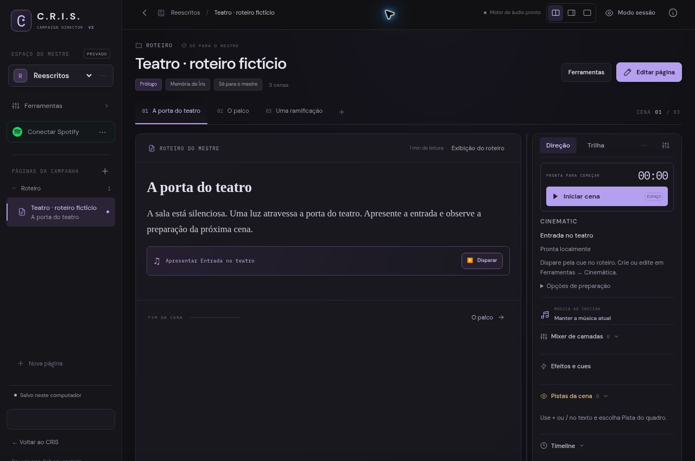
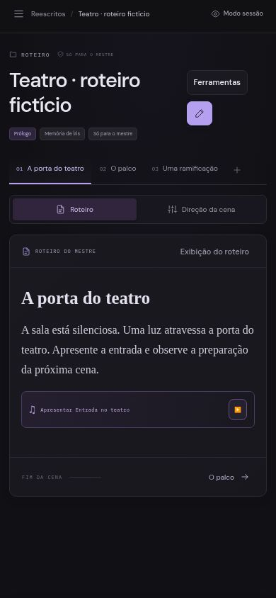
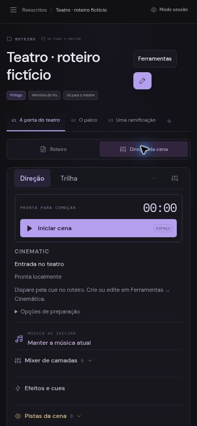

# DIRECTOR-UX-03 — roteiro, cues e preparação

Base: `main` em `277a826`, após o merge do CLOUD-RELIABILITY-01 (#33). Sem merge/publicação desta alteração, gravação em campanhas reais ou mudanças no backend.

## Auditoria e alteração de interface

O PR #32 já trouxe `sceneCinematicCue`, `CinematicCues`, o bloco `cue`, `cinematic-start` e `cinematic-stop`. O disparo continua no mesmo caminho: botão Disparar → trigger/cue do Audio Engine → `CinematicCues.execute` → `CinematicLink.present` → receiver do quadro → coordenador remoto → pré-roll → `CinematicFrame`. Não há outro runner ou player.

`mountSceneCinematic` era chamado com `.document-top`, criando um botão Apresentar, seleção, status e autorização no cabeçalho do documento. Agora é montado uma vez dentro de `#directorScenePane`, na lateral existente. A lateral contém principal, prontidão, encerramento e opções recolhidas de preparação. Não há botão Apresentar duplicado nela. As regras que expandiam o cabeçalho e mudavam a posição da toolbar do editor foram removidas. O encerramento também saiu do cabeçalho da página.

Cues exclusivamente Cinematic já inseridas no texto não são repetidas na grade de efeitos da lateral. Cues compostas com ações de áudio continuam aparecendo normalmente. Nada é removido do documento, das triggers ou dos atalhos.

No mobile, Roteiro e Direção continuam nas abas existentes. O botão da cue agora tem nome acessível explícito (Disparar + nome), pois o CSS existente esconde o texto visível Disparar nos viewports menores.

## Uso

1. Ferramentas → Cinemática: criar/editar/testar a composição e salvar.
2. Direção → Cinematic: escolher a principal se houver alternates. Isso prepara localmente, sem apresentar.
3. No editor do roteiro, posicionar o cursor e usar a opção Cinematic do menu de inserção já existente; escolher a apresentação salva. A cue recebe Disparar no ponto da narração.
4. Ler o texto e disparar a cue. A mídia preparada é reutilizada, mas prontidão do quadro/jogadores ainda é validada antes do pré-roll.
5. Durante a apresentação, somente a próxima principal definida na ordem agrupada de páginas/cenas é candidata. Uma ramificação sem principal interrompe a especulação; não se escolhe uma alternativa arbitrariamente.

## Preload local

A auditoria identificou um defeito concreto: `CinematicSequence.refresh` condicionava até a leitura local a `validBoard(scope)`. Agora a preparação da cena selecionada independe da vinculação do quadro e da autorização remota. O disparo e o envio remoto continuam exigindo a vinculação/autorização existentes.

Durante a reprodução, o trabalho local da próxima candidata usa `requestIdleCallback` quando disponível, com prazo de 1 s; uma cue em primeiro plano promove imediatamente a espera ociosa. Navegação substitui candidatos antigos e libera esperas obsoletas. Continua uma leitura/validação por vez, com no máximo apresentação ativa + uma candidata. O cache de blobs não cria players, canvases ou decodificadores WebM extras. Sem suporte à API de idle, preserva o fluxo serial existente.

Os limites existentes de composição continuam valendo: 24 MiB por composição, até duas entradas locais (pior caso 48 MiB de blobs, com deduplicação por hash na contagem); o cache remoto permanece no orçamento existente de 24 MiB compartilhado entre atual/próxima. Não foi feita promessa de memória total do processo, que também inclui decoder/renderer/browser.

## Conteúdo futuro e criptografia

A autorização remota permanece explícita e recolhida em Direção → Cinematic → Opções de preparação. Não é exigida para preload somente local. O texto explica que antecipar mídia entrega arquivos tecnicamente acessíveis ao jogador. Editar a composição continua revogando a autorização.

A proposta de enviar ciphertext sem entregar a chave é viável como arquitetura, mas não foi implementada nesta etapa. O protocolo atual comprova criptograficamente a identidade do mestre; no sentido inverso, `verified` registra a confirmação do cliente sobre essa prova, não uma credencial assinada de cada participante autorizado. Criptografar e entregar chaves com base somente nesse ACK/ID de conexão não satisfaria a validação exigida. Também seria necessário um ciclo de vida para chaves por sessão/revisão, replay, revogação, reconexão e limpeza de ciphertext, validado independentemente. Portanto, conteúdo futuro privado continua bloqueado. Não há criptografia alegada sem implementação, nova tabela de permissões ou alteração da autenticação.

## Otimização na importação

`cinematic-import.js` recomprime exclusivamente o fluxo IDAT de PNG novo usando CompressionStream/DecompressionStream (`deflate`). Todos os outros chunks (cor, gamma, metadados, dimensões etc.) são preservados byte a byte. Os bytes de pixels filtrados, bit depth, cor e alpha não são alterados, e o CRC novo é calculado/verificado pelos testes. Não redimensiona nem converte o PNG de fallback em WebP.

Somente adota a variante se economizar pelo menos 10% e 32 KiB. Limita a tentativa a PNGs >=128 KiB, até 4 megapixels e 16 MiB de fluxo descomprimido; ultrapassar orçamento, API ausente, arquivo inválido ou nenhum benefício preserva o original. JPEG/WebP existentes e todo WebM (incluindo alpha) ficam intactos. WebP via canvas foi descartado como conversão automática: o encoder do browser não garante modo lossless, e a troca de formato inviabilizaria PNGs que servem de fallback animado.

A importação original é guardada no IndexedDB sob seu próprio SHA-256 antes de usar a variante. A variante recebe outro hash e segue o salvamento normal. Arquivos salvos anteriormente não são recomprimidos; pedidos repetidos para o mesmo Blob reutilizam a Promise via WeakMap. Não há otimização durante a apresentação, transcodificação de WebM ou substituição retroativa de IDs de composições existentes. O original avulso fica local; o manifesto/backup da campanha acompanha os arquivos efetivamente referenciados, incluindo a variante. Não há garantia de replicação em nuvem de originais sem referência.

O exportador/manifesto/hashes do CLOUD-RELIABILITY-01 e o cache temporário da DIRECTOR-CINEMATIC-02 permanecem os mesmos. O novo hash da variante já é validado pelos mecanismos existentes. Falha de backup/sincronização da nuvem continua impedindo confirmação incompleta.

## Primeira apresentação: diagnóstico e limites

O evento `director-start-request` já existe no quadro antes de `remote.present`. Auditoria: o receiver confirma `accepted` antes de preparar mídia/player; a confirmação mantém a comunicação viva durante preparação lenta. Não foi encontrada nos testes uma causa comprovada para o encerramento intermitente relatado no dispositivo do usuário; não foi adicionado retry.

`CinematicLink.diagnostics()` / `window.CRIS_DIRECTOR_CINEMATIC_DIAGNOSTICS()` acrescenta um ring de até 48 eventos: pedido da cue, descoberta, envio, aceitação, início confirmado/falha e reset; inclui fase, quantidade de requests e orçamento local observado. Não inclui tokens, mídia, documento ou identificadores de campanha. Pode ser comparado com `director-start-request`, manifest/ready/pré-roll/started do diagnóstico existente do quadro.

Na demonstração Chrome, imagem simples e composição com WebM tiveram primeiro início confirmado. A captura `director-ux03-webm-play.json` registrou vídeo remoto tocando (readyState 4, 256×512), sem fallback. Em outra sessão fria, `director-ux03-webm-next-local.json` registrou fallback PNG do WebM no jogador (videoFallbacks=1) enquanto o mestre manteve o vídeo; ambos iniciaram. Isso não é comprovação de decoder WebM em todas as tentativas e não foi disfarçado como reprodução de vídeo. O renderer/probe existentes foram preservados; o motivo específico desse fallback ainda precisa de diagnóstico no aparelho real.

## Medições reproduzíveis

Node, Wire/hash/prova/coordenador reais, **rede e players simulados**, dois jogadores, atrasos unidirecionais 12/3 ms, decode simulado 20 ms, pré-roll 1,8 s, PNG de teste ~2 MiB:

| Preparação | Clique → último início | Transferido no disparo (2 jogadores) | Bytes reutilizados | Tempo antecipado |
| --- | ---: | ---: | ---: | ---: |
| Nenhuma | 3.881 ms | 4.194.324 | 0 | 0 |
| Parcial (um pronto) | 2.457 ms | 2.097.162 | 2.097.162 | 8.275 ms |
| Completa | 1.976 ms | 0 | 4.194.324 | 12.180 ms |

Diferença entre inícios: 1 ms em cada cenário simulado. Pico de cache por cliente: 2.113.175 bytes. A apresentação atual não foi remontada. Houve picos observados de atraso de event loop de 3,26/57,56/111,55 ms respectivamente; esses picos impedem afirmar ausência de impacto de CPU/FPS em dispositivos reais. O transporte remoto não foi reescrito/otimizado por esta UI. Limites de janela, ritmo, bufferedAmount e pausa por WebM sem buffers continuam existentes, mas não substituem homologação física.

Amostra de importação gerada sem compressão (1024×512 RGBA; não é arquivo real de campanha):

| Execução | Original | Variante PNG | Economia | Importação |
| --- | ---: | ---: | ---: | ---: |
| Chrome/156 | 2.098.089 B | 598.085 B | 71,5% | 303 ms |
| Node | 2.098.089 B | 747.275 B | 64,4% | 158 ms |

No browser, comparação de RGBA decodificado e alpha foi idêntica. No Node, fluxo filtrado e chunks de cor/metadados foram idênticos. Encoders deflate de runtimes diferentes podem produzir tamanhos diferentes. No benchmark de transferência simulado da importação, original → variante reduziu clique/início de 3.660 para 2.550 ms e tráfego de 4.196.178 para 1.494.550 bytes (dois jogadores). PNG já eficiente conserva o original; não prometer esses percentuais para fotografias ou arquivos já otimizados.

Reproduzir:

```sh
npm --prefix campaign-director run check
npm --prefix campaign-director test
node campaign-director/scripts/check-integration.mjs
node campaign-director/tests/fixtures/cinematic-prewarm-benchmark.mjs
node campaign-director/tests/fixtures/cinematic-import-benchmark.mjs
node campaign-director/tests/fixtures/director-ux03-demo.mjs /workspace/scratch/qa-novo
```

A última linha gera uma fixture descartável, com contas/campanha fictícias e transporte simulado. Nunca publicar a fixture. Usar o preview interno para abrir a pasta gerada. Os benchmarks devem rodar sem a suíte concorrendo por CPU.

## Verificação e capturas

**624 testes aprovados** (615 da base + 9 regressões), check e check-integration aprovados. Regressões: PNG sem perda/CRC/alpha/metadados, original preservado, formatos/orçamento sem conversão, preparo local sem vínculo, mídia disponível após recuperação da nuvem, promoção de idle para cue, lateral/principal/autorização, nome acessível mobile e ring de diagnóstico limitado.

Chrome em fixture: selecionar cena, principal/alternates, leitura e cue, primeiro início de imagem, próxima remota pronta, primeira composição WebM, próxima privada preparada somente localmente durante apresentação, encerramento e navegação; viewports Director 1280 px e 390 px, jogador 390×844. UI, player e armazenamento do browser reais; contas, backend e rede simulados, mesmo perfil. Não homologa WebRTC, Supabase/RLS ou dispositivo físico. As regressões de substituição, reconexão, cache temporário e nuvem existentes passaram na suíte; não se confundem com teste físico.

Capturas em `validation/director-ux03/`: desktop sem tarja, mobile roteiro e mobile direção; JSONs do diagnóstico, preload e importação. Capturas durante uma reprodução retornaram timeout na API de screenshot; as capturas de interface foram obtidas fora da reprodução, e o playback foi verificado por estados e elementos de vídeo. Não há captura inventada de um Android.





## Arquivos e validação manual restante

- `app.js`, `cinematic-scene-ui.js`, `cinematic.css`, `markdown.js`: montagem lateral, fluxo da cue e acessibilidade.
- `cinematic-sequence.js`, `cinematic-link.js`: preload local/idle e diagnóstico.
- `cinematic-import.js`, `cinematic-editor.js`, `cinematic-layers-editor.js`: recompressão na importação.
- `index.html` e imports alterados: atualização seletiva de assets do Director (`directorux03`), preservando renderer/protocolo v4 e os módulos cloud já versionados.
- Testes, fixtures e evidências neste diretório: repetição das verificações sem tocar em dados reais.

Antes de liberar: Windows mestre + Android físico com rede real; PNG de campanha e WebM alpha representativos; primeira tentativa após abrir app; cenas com principal/alternates; cue, pré-roll, substituição, encerramento e reentrada; observar phase/code/fallbacks, FPS e picos de memória durante preload. Conteúdo futuro não autorizado deve gerar zero tráfego de mídia/chave. Validar também a sincronização em nuvem real em ambiente isolado conforme CLOUD-RELIABILITY-01. Não prometer início instantâneo com mídia pendente nem retirar a autorização remota antes de existir identidade de participantes e distribuição de chaves verificadas.
